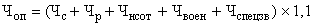

# Tasks

-# Tasks 15

-## 1. Структура и конструктор проекта контракта по ст. 34 и 51 🟢 Реализовано (2026-11-19).

Проект контракта стал отдельным конструктором после извещения: 8 видов контракта, разделы по ст. 34 и 51, специальные разделы (управление, проектная документация, права на РИД, содержание, стройконтроль), приложения, предзаполнение по цепочке извещение → СЗ → ООЗ → карточка заказчика, предпросмотр текста и проверки обязательных условий. Подробности — `.koda/PROJECT_STATE.md` §28.

-# Сверка статусов с кодом — 2026-11-18

> Что реально лежит в репозитории на момент сверки. Подробный разбор — `.koda/PROJECT_STATE.md` (домены, defectLists, НМЦК, ЭП и шлюз ЕИС).

**🟢 Сделано целиком (считаем закрытым):**

- **Tasks 8 п.4** — роль «инициатор закупки»: `/defect-lists` + описания объектов закупки, дефектовка позициями, проект сметы (приказ 421/пр) и проект календарного графика (336/пр), «направить в КС» → задача ответственному.
- **Tasks 9 п.1** — журнал ЭП, вход по ЭЦП и подписание документов реальной ЭП заказчика в нашем интерфейсе (откреплённая CAdES-BES, локальная проверка `VerifyCades`).
- **Tasks 9 п.6 и п.7** — демо СМП целиком: `contractSmpRecords`, пять дедлайнов по ПП 1466 + срок заказчика по ч. 3 ст. 103, контроль объёма, неустойка, выгрузка в ЕИС, акты `pp-1466` и `law-44fz-art103-p3` в `legalActs`.
- **Tasks 10** — модалки отчётов СМП и загрузка файла-основания. **Tasks 11** — чекпоинты процесса по контракту `contractEvents`.
- **Планирование и обоснование:** план-график по форме 145/206н, справочник ОКПД2 (нормирование ПП 926/1047 и аукционный перечень РП РФ 471-р), контроль превышения предельной цены с понижением подписью руководителя КС, расчёт НМЦК двумя методами — анализ рынка (ст. 22, приказ МЭР 567) и нормативный (ст. 19, ч. 7 ст. 22, ПП 926/1047), расчёт живёт в служебке и выгружается обоснованием в .docx, служебка по позиции ПГ с выгрузкой .docx/.pdf и реестр потребностей.

**🟡 Начато, не закрыто:**

- **Tasks 9 п.4 и Tasks 8 п.2 (а)** — исходящий канал в ЕИС: шлюз `csms-api` и экран `/eis/packages` (переходы статусов, ошибки ФЛК, подпись на рабочем месте). Генерация XML по XSD и SOAP/mTLS — заглушки.
- **Tasks 3 11:16 п.4 и п.5b** — СМП по контракту: подрядчика эмулирует заказчик, нет флага «подрядчик сам СМП», нет руководителя направления функций. 🟢 В выгрузку добавлены ОКПД2, вид цены и цена за единицу (2026-11-19).
- **Tasks 12 §3–§5** — тарифные флаги `activeModules` (Zustand не используется), ролевые секции служебки со слепком данных, поля `eisGuid`/`eisStatus`/`flkErrors` в документах (есть только в DTO пакета), таймер предельного срока оплаты.

**🔴 Не начиналось:** Tasks 9 п.3 (срезы ПГ/реестра/извещений), Tasks 8 п.2 (в) чтение из ЕИС, Tasks 3 11:16 п.6–п.7 (модуль нагрузки, автопринятие задач, составные задачи), Tasks 7 п.5 (особые закупки), Tasks 9 п.2 (реквизиты по ИНН — ждёт реального бэкенда).

-# Tasks 14

-## 1. Парсер/интеграционный клиент ЕИС 44-FZ — SOAP-сервис `getDocsIP` 🟢 Реализовано (2026-11-19).

Отдельное решение **.NET 9** в `eis-parser/` (не смешивается с фронтендом): `Eis44Parser.Core` (SOAP-клиент, сборщик запросов, парсер XML, модели), `Eis44Parser.Data` (EF Core: SQLite/PostgreSQL, таблица `Tenders`, ключ по номеру закупки), `Eis44Parser.Worker` (фоновая служба опроса + CLI `--once` / `--validate`), `Eis44Parser.Tests` (5 xUnit-тестов). Подробности и инструкции — `eis-parser/README.md`.

Что сделать по спецификации:

1. **Туннель ГОСТ-TLS.** `HttpClient` идёт не напрямую в `int44.zakupki.gov.ru:443`, а в локальный Stunnel `http://127.0.0.1:8080` (`[eis-44] client=yes / accept=127.0.0.1:8080 / connect=int44.zakupki.gov.ru:443`). WSDL `https://zakupki.gov.ru?wsdl`, XSD `?xsd=getDocsIP-ws-api.xsd`.
2. **SOAP-конверт.** В `<soapenv:Header>` обязателен `<individualPerson_token>` (токен ИП из ЕСИА/Госуслуг, личный кабинет участника закупок). Теги идут строго по `xs:sequence` — порядок зафиксирован в `SoapRequestBuilder`, покрыт тестами. Коды подсистем: `PRIZ` (извещения/протоколы), `RPEC` (реестр контрактов), `RPGZ` (планы-графики), `NSI` (справочники).
3. **Двухэтапное получение.** Этап 1 — `getDocsByOrgRegionRequest` (по региону и дате) или `getDocsByReestrNumberRequest` (по 19-значному номеру) → `archiveUrl`. Этап 2 — `HTTP GET` ZIP через тот же туннель с заголовком `individualPerson_token`, XML внутри разбирается через `XDocument` по `Name.LocalName` (не ломается от префиксов и разных `schemeVersion`).
4. **Надёжность.** Лимит ЕИС ~8 RPS — запросы последовательные; повторы 429/5xx/сетевых ошибок через Polly с экспоненциальной задержкой. Дедупликация по `PurchaseNumber` и версии документа: повтор пропускается, изменённая версия обновляет запись.
5. **Конфигурация.** Адрес туннеля, регионы, типы документов и подсистемы вынесены в `appsettings.json`; токен ИП лежит в User Secrets вне репозитория, переопределяется через `Eis44__IndividualPersonToken`. Скрипт `schemas/generate-models.ps1` генерирует строгие модели из XSD Альбома ТФФ через `dotnet-xscgen` (не `xsd.exe`).

Проверки: `dotnet build eis-parser/Eis44Parser.sln` и `dotnet test eis-parser/Eis44Parser.sln` — зелёные (5/5); `dotnet run --project src/Eis44Parser.Worker -- --validate` создаёт БД и печатает конфигурацию без обращения к ЕИС. Установлен stunnel-msspi 0.84 (`C:\Tools\stunnel-cpro`), подготовлены `eis-parser/stunnel.conf` и скрипт `scripts/start-stunnel.ps1` (PIN запрашивается и пишется в `%TEMP%`, в git не попадает); режим `--check` печатает состояние токена и TCP-пинг туннеля. 🟡 Живой обмен заблокирован сервером ЕИС: `int44.zakupki.gov.ru:443` сбрасывает TLS-handshake (`SocketException 10054`) до прикладных данных — из stunnel-msspi, из `csptest` и при «сыром» ClientHello с suite `ff85`. Тот же stunnel успешно делает handshake с Google, значит локальный контур исправен; нужны доступ/белый список IP или рабочий контур ЕИС. VPN включался и выключался — эффекта нет. Токен ИП вынесен в User Secrets вне репозитория (старая копия осталась в истории публичного репозитория `eecaca5`, подлежит перевыпуску). XSD в `schemas/Schemas44/` ещё не загружены (папка с `.gitkeep`).

-# Tasks 12

-## 1.

# Архитектурный контекст проекта: Модульная SaaS-платформа управления закупочным циклом (44-ФЗ)

🟡 **Статус сверки с кодом (2026-11-18).** 🟢 Закрыто: весь фронтенд-контур §4 (React 19 + TS + RHF/Zod + TanStack Query + SCSS-модули, сервисный слой изолирован, `baseURL` читается из `VITE_API_URL`), mock-API с ролями §4, криптография §4 (КриптоПро Browser plug-in: чтение сертификатов, откреплённая CAdES-BES, локальная проверка `VerifyCades`, вход по ЭЦП), ядро `CORE` §3 — аудит-лог подписей `edsSignatureEvents` и чекпоинты `contractEvents`, внутренняя инициация §2.1 в части служебки (ООЗ, НМЦК, выгрузка `.docx`/`.pdf`), исполнение §2.3 в части реестра, этапов, платежей, приёмки, неустоек и СМП. 🟡 Начат исходящий поток §5.2 п.3: шлюз `csms-api` + экран `/eis/packages` (подпись на рабочем месте, сверка хеша, статусы и ошибки ФЛК) — но XML по XSD и SOAP/mTLS пока заглушки. 🔴 Нет: тарификация и `activeModules` §3, ролевые секции служебки со слепком данных §2.1, поля асинхронного обмена §4 в документах (только в DTO пакета), таймер оплаты 7 рабочих дней §2.3, весь C#-пайплайн §5. Подробно — служебная заметка `.koda/PROJECT_STATE.md`.

🟡 **Шаг по исходящему XML сделан (2026-11-19).** В соседнем репозитории
`csms-api` добавлен каталог XSD `EisSchemaCatalog` (`schemas/<версия>/*.xsd`,
переменная `EIS_SCHEMAS_ROOT`): он компилирует `XmlSchemaSet` и проверяет XML
до сохранения/packages, но честно молчит, когда схем для версии нет — генератор
остаётся `placeholder-v0`. `EisPackageArchiver` собирает подписанный пакет
в ZIP (XML + `.sig`) в памяти; заглушка транспорта теперь тоже упаковывает.
Тесты шлюза: 25 пройдено, 2 PostgreSQL-теста пропущены без `EIS_TEST_DB`.
В `csms` восстановлен роут `/eis/packages` и ссылка «Пакеты ЕИС» в шапке (их
случайно удалил коммит `2fe42e2`). Настоящий XML по XSD по-прежнему ждёт
Альбома форматов ЕИС — без схем его изображать нельзя.

**Автообновление XSD Альбома (2026-11-19).** Нашёлся официальный публичный
источник: страница документов ЕИС (`sectionId=432`) выкладывает ZIP
«Интеграционные схемы ЕИС версии X.Y». В `csms-api` добавлен
`EisSchemaDownloader` + `EisSchemaUpdateWorker`: раз в 12 часов (и сразу при
старте) шлюз читает страницу, скачивает свежий архив, проверяет размер/пути и
компилирует XSD, затем атомарно подменяет `schemas/<версия>/`. Есть статус
`GET /api/eis/schemas/status` и ручной `POST /api/eis/schemas/update`.
Проверено на живом сайте: установлено 32 XSD версии 17.0, `id=44668`,
`smoke.ps1` — 11/11. Официальный архив содержит дефект в
`getDocsLE-ws-api.xsd` (лишний `>` после XML-декларации) — загрузчик убирает
его с предупреждением в лог. Важно: это **общие** интеграционные схемы ЕИС;
XSD для наших документов (исполнение контракта, СМП) в них нет, поэтому
`PlaceholderXmlBuilder` остаётся заглушкой — маппинг полей пишется человеком.

## 1. Целевая аудитория и границы предметной области (Scope)

- **Целевой сегмент:** Малые и средние государственные/муниципальные заказчики (школы, ДОУ, учреждения культуры, администрации, ГБУ/МКУ).
- **Нормативный контур:** Исключительно стандартные конкурентные и неконкурентные процедуры **44-ФЗ** (электронные аукционы, конкурсы, запросы котировок, едпоставщик по п. 4, 5 ч. 1 ст. 93).
- **Строгие исключения (Out of Scope):** Система **не поддерживает** медицину (ЖНВЛП, специфические приказы Минздрава по НМЦК), закрытые способы определения поставщиков и узкоотраслевую экзотику. Код и схемы данных не перегружаются редкими исключениями ЕИС.
- **Роль в ЕИС:** Платформа работает как единая **Внешняя система (ВС)** по модели SaaS-подписки. Заказчик подключается, выдавая права нашей ВС в своем личном кабинете ЕИС.

## 2. Бизнес-логика и сквозной жизненный цикл (End-to-End)

Система не дублирует интерфейс ЕИС, а расширяет работу контрактной службы (КС) внутри организации заказчика от момента возникновения потребности до закрытия контракта:

1. **Внутренняя инициация (Единая служебная записка):**
      - Единая композитная сущность, собирающая данные от разных подразделений в изолированных ролевых интерфейсах со строгой валидацией:
        - **Инициатор:** ТЗ, характеристики, ОКПД2/КТРУ, сроки поставки.
        - **Сметчик:** расчет и обоснование НМЦК, коммерческие предложения.
        - **Бухгалтер:** финансовые условия (сроки оплаты по 44-ФЗ, КБК, лицевые счета, банковские реквизиты).
        - **Контрактная служба (КС):** проверка сборки, контроль распределения нагрузки сотрудников и учет квот (в т.ч. СМП).
      - **Контроль нарушений:** По каждой секции собирается персональная подпись ответственного сотрудника с сохранением слепка данных (аудит-лог) для однозначного определения виновного при выявлении нарушений.
2. **Интеграция с ЕИС (Планирование и торги):**
      - Автоматическая трансформация согласованной служебки в XML-пакеты (позиция плана-графика, извещение) и отправка в ЕИС через шлюз ВС.
      - Загрузка итоговых протоколов из ЕИС, фиксация победителя и автоматический пересчет спецификации контракта с учетом коэффициента снижения.
3. **Исполнение контракта (Ролевой контроль):**
      - **Приемка (Инициатор):** загрузка электронного УПД из ЕИС -> сверка фактической поставки против исходного подписанного ТЗ -> формирование и отправка титула заказчика (приемка / мотивированный отказ) в ЕИС.
      - **Оплата (Бухгалтер):** автоматический таймер предельных сроков оплаты (7 рабочих дней) на базе реквизитов из служебки -> фиксация платежного поручения -> выгрузка сведений об оплате в Реестр контрактов ЕИС.
      - **Претензионная работа и закрытие (КС / Юрист):** автоматический расчет пеней/штрафов при просрочке, генерация требований об уплате неустойки, выгрузка сведений о завершении или расторжении контракта в ЕИС.

## 3. Модульная архитектура и тарификация (Feature Flags)

Система проектируется с расчетом на продажу отдельными модулями (для укладывания в лимиты прямых договоров по п. 4/5 ч. 1 ст. 93 44-ФЗ):

- **`CORE` (Базовое ядро):** ЛК организации, стартовая синхронизация карточки заказчика и справочников НСИ из ЕИС, ролевая модель, аудит-лог подписей.
- **`PRE_EIS_MEMO` (Модуль 1 — Внутренняя сборка и План-график):** Единая служебная записка по отделам и автовыгрузка в план-график ЕИС.
- **`EXECUTION_CONTROL` (Модуль 2 — Исполнение и Контроль оплаты):** Приемка УПД по ТЗ, таймеры сроков оплаты, выгрузка в Реестр контрактов.
- **`CLAIMS_ANALYTICS` (Модуль 3 — Претензии и Аналитика):** Расчет неустоек, генерация претензий, аналитика выборки лимитов и нагрузки КС.

**Технические требования к модульности:**

- На фронтенде (Zustand / React Query) доступ к роутам, пунктам меню и блокам интерфейса регулируется массивом `activeModules` из профиля организации (`Tenant`).
- На бэкенде проверка модулей тарифа выполняется через кастомные атрибуты авторизации (например, `[RequireModule("EXECUTION_CONTROL")]`).
- В БД сущности этапов связаны слабо (через `Guid` базовой закупки), чтобы модуль исполнения мог работать автономно на данных, подтянутых напрямую из ЕИС, даже если у клиента не куплен модуль служебных записок.

## 4. Технологический стек и правила генерации кода

- **Frontend (текущий этап):**
    - React, TypeScript (строгая типизация, поля в camelCase/строго типизированные DTO).
    - React Router (источник истины для навигации), Zustand (UI-состояния), TanStack Query / React Query (серверное состояние и поллинг статусов пакетов ЕИС).
    - React Hook Form + Zod (базовая универсальная схема с опциональными полями для общего просмотра + строгие ролевые дочерние схемы с обязательными полями для валидации конкретных отделов).
    - Sass (SCSS-модули, методология БЭМ, без Tailwind).
    - Криптография: КриптоПро ЭЦП Browser plug-in (`cadesplugin_api`) для наложения отсоединенной УКЭП сотрудника в браузере (Base64 PKCS#7).
- **Mock API (этап прототипирования):**
    - `json-server` с имитацией авторизации и ролей. Все запросы изолированы в сервисном слое; переход на прод должен выполняться заменой `VITE_API_URL` без рефакторинга компонентов.
    - В DTO документов обязательно закладывать поля асинхронного обмена с ЕИС: `eisGuid`, `eisStatus` (`DRAFT` | `SIGNING` | `SENT_TO_EIS` | `FLK_CHECKING` | `ACCEPTED_IN_LK` | `REJECTED_BY_FLK`), `flkErrors: Array<{ code: string; field?: string; message: string }>`.
- **Backend (целевая архитектура):**
    - **C# (.NET 8/9)**, ASP.NET Core, Entity Framework Core (PostgreSQL), FluentValidation.
    - Интеграция с ЕИС: SOAP/mTLS шлюз `int44.zakupki.gov.ru`, КриптоПро .NET SDK (подпись транспортного конверта сертификатом ВС).

## 5. Пайплайн форматов данных и парсинга на C#-бэкенде (Data Pipeline)

Бэкенд выступает строгим адаптером между REST JSON (для React-фронтенда) и SOAP/XML-пакетами ЕИС:

### 5.1. Входящий поток (Парсинг данных из ЕИС в систему)

При получении ответов от сервисов ЕИС (`getDocsMis2`, `getProcessingResult`, справочники НСИ, электронные УПД):

1. **Распаковка транспорта:** Извлечение Base64-строки из SOAP-ответа -> декодирование в поток байтов -> распаковка ZIP-архива в памяти (`System.IO.Compression.ZipArchive`) без сохранения временных файлов на диск.
2. **Десериализация XML:** Определение типа документа по корневому тегу и `xmlns` -> десериализация через `System.Xml.Serialization.XmlSerializer` в строго типизированные C#-модели, сгенерированные из XSD-схем Альбома форматов ЕИС (`XmlSchemaClassGenerator` / `dotnet-xscgen`).
3. **Маппинг в доменную модель и DTO:** Преобразование XSD-объектов в сущности БД (EF Core) и плоские JSON DTO для фронтенда (через `Mapster` или `AutoMapper`).
4. **Хранение сырого слепка:** Оригинальный XML-файл и отсоединенная подпись (`.sig` / Base64) обязательно сохраняются в объектное хранилище (S3 / MinIO) или `jsonb`/`xml` поле БД для юридической значимости и разбора спорных ситуаций при проверках.

### 5.2. Исходящий поток (Сборка и отправка пакетов в ЕИС)

При отправке документов из ролевых интерфейсов (План-график, Извещение, Титул приемки, Сведения об исполнении):

1. **Валидация на входе:** Проверка входящего JSON от фронтенда через `FluentValidation` (дублирование правил ФЛК ЕИС до этапа генерации XML).
2. **Сборка XSD-объекта и XML:** Маппинг доменной сущности БД в сгенерированный XSD-класс C# -> сериализация в UTF-8 XML через `XmlSerializer` с соблюдением порядка тегов и пространств имен (`XmlSerializerNamespaces`).
3. **Подписание и упаковка:**
      - Наложение отсоединенной УКЭП сотрудника заказчика (полученной с фронтенда от КриптоПро Browser Plug-in в Base64) на сформированный XML-файл.
      - Упаковка XML-документа и файла подписи (`.sig`) в единый ZIP-архив в памяти -> кодирование архива в Base64.
4. **Отправка в шлюз:** Формирование SOAP-конверта, подписание транспортного заголовка сертификатом Внешней системы (КриптоПро .NET SDK) и отправка по ГОСТ mTLS на `int44.zakupki.gov.ru`.

### 5.3. Правила версионирования XSD-схем ЕИС

- Сгенерированные из XSD C#-классы изолируются в отдельном проекте/неймспейсе с привязкой к версии Альбома форматов ЕИС (например, `Eis.Schemas.V14_2`, `Eis.Schemas.V15_0`).
- Бизнес-логика БД и DTO фронтенда **никогда не зависят напрямую** от сгенерированных XSD-классов — связь идет только через слой мапперов, чтобы квартальные обновления форматов ЕИС не требовали переписывания фронтенда и базы данных.

-# Tasks 11

-## 1. Чекпоинты процесса по контракту (Tasks 8 п. 2 б) 🟢 Готово. Новая коллекция `contractEvents`: этап (`project_created` → `customer_approved` → `supplier_signed` → `customer_signed` → `registry_included` → `execution_started` → `acceptance` → `payment` → `completed`/`terminated`), дата события, снимок ФИО отметившего, документ-основание, комментарий. В карточке реестра — таймлайн с отметкой шагов, инлайн-форма «+ Отметить этап» (подставляет ближайший неотмеченный шаг), удаление отметки и правка уже созданной (кнопка «✎»: та же форма, автор и дата ввода сохраняются, в записи появляется `updatedAt`); сведения пишутся в `/contractEvents`, из ЕИС не тянутся — это наш журнал (Tasks 8 п. 2 б: «чекпоинты — наша зона ответственности»). Сиды: контракт 1 — 6 событий, контракт 2 — 9, контракт 5 (org6) — 6. Отправка XML (п. а) и чтение из ЕИС (п. в) остаются 🔴.
**Побочный результат — мина json-server.** Первый же `DELETE` показал, что он вычищает связанные записи: пустая коллекция `"contracts": []` делала `contractId` «битой» ссылкой (удалялись этапы, платежи, неустойки, поставки, записи СМП, события ЭП всех контрактов), а `null` в `*Id` (`organizationId` приказных функций, `purchasePlanId/positionId` служебки id4) валил `getRemovable`. Исправлено в `db.json`: коллекция `contracts` удалена (её никто не запрашивал), пустые `*Id` убраны, у контракта 5 сняты заглушки `contractProjectId: 0`/`procurementId: 0`. Контроль — скрипт, повторяющий `getRemovable`: «no removable». Детали — `.koda/PROJECT_STATE.md` §1 и §7.

-# Tasks 10

-## 1. Модалки создания/правки на странице отчётов СМП и загрузка файла-основания. 🟢 Готово.
**Модалки отчётов СМП.** `src/components/Reports/SmnpSonekModal.tsx` — одна форма на три сущности (`plan` / `report` / `procurement`), режимы создания и правки, поля по типу записи (план: плановые суммы и доля; отчёт: факт, доля, статус, дата в ЕИС; закупка: ИКЗ, поставщик, способ, цены, даты). Страница `SmnpSonekPage.tsx` переведена с пустых `handleCreate`/`handleEdit` на `openCreateModal` / `openEditModal` и состояние `modalState`; хуки `useCreateSmnp...`/`useUpdateSmnp...` теперь вызываются. В схему добавлены `emptySmnpProcurement()` и объединяющий тип `SmnpSonekRecord`.
**Где вносить сведения о привлечении СМП.** Это не страница отчётов: форма живёт в карточке контракта — `ContractRegistry/ContractSmpSection.tsx` (подключена в `ContractRegistryPage.tsx`), кнопка «+ Загрузить сведения» → `ContractSmpRecordForm`. Отчёты на `/reports/smnp` — это годовой срез (ч. 1 ст. 30), а сведения по контракту (ч. 5-6 ст. 30) заводятся у контракта.
**Что в форме не было — загрузка файла-основания.** Поле `sourceFileName` в схеме существовало, но ввести его было нельзя, всё набиралось руками. Добавлено: `src/services/ContractSmp/sourceFile.ts` — чтение только имени файла (содержимое не читается и никуда не уходит, как решено в Tasks 9 п.6 п/п 4), из номера и даты из имени (`№123`, `акт_45`, `пп-9`, `2026-01-15`, `15.01.2026`), год отсекается, чтобы `2026` не стал номером договора; в форме — input файла, плашка «из имени файла прочитано: номер, дата — проверьте», плашка «не найдено — внесите вручную», имя файла в бэке, кнопки «Очистить». Подстановка идёт только в пустые поля: введённое вручную не перетирается, потому что достоверность подтверждает человек (п. 6 ПП 1466). Заодно в форму выведены поля «Предмет документа» (`subject`) и «Период» (`period`), которые были в схеме, но не было в интерфейсе.
**Что осталось:** распознавание содержимого (текстовый слой PDF через pdfjs-dist, сканы через OCR) — отдельная задача на 2-3 + 2-3 дня, вход подрядчика по ссылке-приглашению — отложен.

-# Tasks 9 (продиктовано вслух, записано дословно, чтобы модель не потерялась)

-## 1. Заключаем контракт с заказчиком, так как мы удобный и прогрессивный сервис — руками их ничего не требуем хардкорить. Если нужна ЭЦП, но она в любом случае у заказчика есть, мы её требуем в том числе в договоре, тупо пишем логирование по ЭЦП или email. 🟢 Реализовано в главном (2026-11-18): ЭП остаётся у заказчика и ставится в нашем интерфейсе, детали — в конце пункта. Уточнение автора: передавать нам ЭП никто не собирается, ответственность за подписание остаётся за контрактной службой, наша роль — удобство, структура и централизация плюс функционал, которого в ЕИС нет. Мысль верная по намерению и опасная по формулировке, поэтому разделим. **Что нельзя:** принять УКЭП заказчика «к себе» и подписывать за него. Квалифицированная подпись выдаётся конкретному физическому лицу, а ключ по ст. 10 63-ФЗ обязан храниться в тайне и не передаваться третьим лицам; ключевые контейнеры по ГОСТ лежат на сертифицированном токене (Рутокен ЭЦП, JaCarta-2 ГОСТ) и наружу не извлекаются. Подпись чужой ЭП — это не «удобно», это недействительный документ и наша прямая ответственность, плюс при проверке Казначейства или ФАС вскрывается мгновенно. **Что делаем вместо этого:** подпись остаётся у заказчика, но ставится не в ЕИС, а в нашем интерфейсе. Технически это компонент подписания на рабочем месте пользователя — КриптоПро ЭЦП Browser plug-in (или КриптоПро JCP на их сервере): мы собираем документ, показываем, что именно подписывается, человек вставляет свой токен и жмёт «Подписать», подпись уходит вместе с документом. Для пользователя это выглядит ровно как ты хочешь — он никуда не уходит и ничего не переносит руками. **Что правильно требовать в договоре:** наличие действующей УКЭП у уполномоченного сотрудника и МЧД на представителей, готовность подписывать документы в нашем интерфейсе, доступ к тестовому контуру ЕИС для отладки, согласие на обработку ПДн. Не «отдайте нам ЭП». **Про логирование:** журнал действий (кто, когда, чем подписал, какой email подтвердил) ведём обязательно — но это аудит и удобство, а юридический факт подтверждает сама подпись, лог её не заменяет. 🟢 Журнал ЭП реализован (EdsJournalPage, EdsSignModal, EdsCertificateSchema, парсеры ИНН/СНИЛС/ФИО, события в журнал). **Вход по ЭЦП реализован** (EdsLoginForm: выбор сертификата, challenge-response через плагин, сопоставление ИНН/ФИО с базой, вход через localStorage.user*email, запись события в журнал). 🟢 **Подписание документов реальной ЭП заказчика — реализовано (2026-11-18):** `src/services/Eds/pluginSign.ts` — откреплённая CAdES-BES через `CAdESCOM.CadesSignedData` (`signText`, `signBytes`, запись свойств через `propset*`), офлайн-проверка подписи `VerifyCades` (`verifyTextSignature`, `verifyBytesSignature`); подписываются пакет сведений о СМП (`smpPackage.ts`, экран `/eis/smp-export`) и пакет ЕИС на экране /eis/packages (шлюз csms-api); проверка рабочего места и сертификатов — /eds/diagnostics. Не закрыто: серверная верификация подписи — json-server подпись не проверяет, это часть перехода на реальный бэкенд.

-## 2. Мы имеем ИНН, да и много ещё — вроде у налоговой есть API, чтобы красоту с данными заказчика загрузить себе. 🟡 Частично реализуемо, ждёт перехода на реальный бэкенд. Источник реквизитов по ИНН действительно есть и он бесплатный: открытый ЕРВЮЛ (выгрузка ЕГРЮЛ/ЕГРИП от ФНС, обновляется ежемесячно — наименование, адрес, руководитель, статус) и реестр МСП для проверки права на преференции по ч. 1 ст. 30. Платный официальный API ФНС даёт выписку по запросу, но ключ выдаётся по заявке, это календарные недели, а не дни. Коммерческие сервисы (Дадата и аналоги) решают ту же задачу за деньги и без заявок. Отдельно зафиксируем: ИНН заказчика — это ещё и ключ ко всем остальным каналам (срезы из п.3, истории контрактов, проверок), поэтому справочник идентификатор между нами и ЕИС — обязательная деталь, там у одного лица три кода: ИНН, внутренний `organizationId` и 11-значный `organizationCode`.

-## 3. Нам нужны его срезы, без которых мы просто бесполезны: ПГ, реестр контрактов, текущие извещения. 🔴 Не реализовано, это ядро. ⚠️ Уточнение 2026-11-18: основным каналом обмена стала модель «мы — Внешняя система» (шлюз `csms-api`, Tasks 12 §5.2), поэтому парсинг публичных страниц ниже — fallback для чтения до подключения ВС. Канал чтения — публичные страницы ЕИС (они рендерятся на сервере, без JS), выборка только по ИНН обслуживаемых заказчиков, окно — три года или текущий год, «хвосты» до окна ловим по своим полям (`status` в signed/in_execution/suspended, пустая `completionDate`, номер закупки у позиции ПГ). Подробности и ограничения расписаны в Tasks 8 п.2. По трудоёмкости внутри этого пункта три разных reader-а, и самый тяжёлый — план-график: у него вложенная структура и печатная форма, а не плоская таблица. Реестр контрактов и извещения читаются заметно проще.

-## 4. Заказчик должен прочувствовать наш интерфейс как родной, а интерфейс ЕИС ему неудобен, поэтому перенаправлять туда не должны; имея его ЭЦП, совершаем все действия в ЕИС. На старте 1-2 заказчика — это здорово. 🟡 Начато (2026-11-18): есть экран `/eis/packages` и шлюз `csms-api` — пакет проходит путь `Draft → Signing → Signed → SentToEis → FlkChecking → AcceptedInLk / RejectedByFlk`, документ подписывается на рабочем месте заказчика, шлюз сверяет хеш подписанного и отказывает при расхождении, ошибки ФЛК приходят данными (код, поле, текст). Генерация XML по XSD и SOAP/mTLS — заглушки (`PlaceholderXmlBuilder`, `MockEisTransport`). В целом это и есть продукт, а не фича. Формулировка «ЕИС как бэкенд, а не как интерфейс» — правильная цель, и достижима она для основной части действий заказчика: план-график, извещение, реестр контрактов, обоснования, отчёты. Два честных ограничения, которые надо принять заранее. **(а)** Момент подписания всегда касается их токена — см. п.1, это один клик в нашем окне, но не наш сервер с их ключом. **(а2)** Торги идут на электронной площадке (ЭТП), это третья система: действия участников и протоколы живут там, и часть маршрута («посмотреть протокол на площадке») закрыть нельзя — зато все наши документы и сведения формируются у нас. **(б)** Про «статус информационной системы» — интуиция тебя не подвела, но эффект обратный: статус ГИС/требования к ИСПДн (класс защищённости, аттестация по приказам ФСТЭК) — это про безопасность и он **удорожает и удлинит** нашу жизнь, а не упростит. Он никак не отменяет XML: схемы документов, которые принимает ЕИС (правила 658/215н для плана-графика, 918 для реестра контрактов), — это формат разговора с ЕИС, он был, есть и будет, и меняться будет тоже. Так что да: с XML мы будем мучаться и дальше, плюс держать мониторинг, потому что после очередных правок схем что-то отваливается, и узнавать об этом надо по автотесту на контрольных закупках, а не по звонку заказчика.

-## 5. Оценка по пунктам 1-4 (календарно, только моя работа в коде; без ожидания твоих ИНН, договоров и заявок в ведомства) - Уточнение к формату: все сроки в файле — только моя работа в коде, накопление данных, договоры, заявки в ведомства и ИНН пилотов в них не входят и двигают календарь отдельно. - Справочник идентификатор + загрузка реквизитов по ИНН из открытого ЕРВЮЛ (п.2): **3-5 дней**. - Чтение реестра контрактов и текущих извещений по своему списку ИНН, сопоставление с нашей базой, журнал расхождений (п.3): **2-3 недели**. - Чтение плана-графика и приведение к нашей структуре позиций (п.3, самое тяжёлое): **+1,5-2 недели**. - Компонент подписи на стороне заказчика через криптографический плагин браузера, включая сценарий «токена нет/не тот сертификат/истёк» (п.1): **1,5-2 недели**. - Первый тип исходящего документа в ЕИС (предлагаю план-график) — сборка XML по их схеме, валидация до отправки, обработка протокола несоответствия (п.4): **4-6 недель**, и дальше +постоянное сопровождение схем. - Итого до состояния «1-2 пилотных заказчика ведут ПГ у нас и никуда не уходят»: **около 2,5-3,5 месяцев** моей работы при условии, что доступ к тестовому контуру ЕИС и ЭП пилота готовы заранее. Дешёвая промежуточная точка, которую стоит показать пилоту раньше: чтение срезов + наш интерфейс + подписание через плагин, а отправка XML вторым шагом. - Что в эти сроки НЕ входит и двигает календарь снаружи: договор и формулировки про ЭП (юрист), заявка на доступ в контур ЕИС «Тест», ключ API ФНС, аттестация ИСПДн если пойдём в ПДн, и реальные ИНН пилотов — без них сверка матчинга бессмысленна.

-## 6. Первое демо — внесение сведений по привлечению СМП (в прошлой фразе я опечатался, имелась в виду не ЭЦП). У меня есть ЭЦП на компе и живой тестер, поэтому хочется дойти до этого функционала быстрее. 🟢 Демо реализовано (см. Tasks 10 п.1): сущность `contractSmpRecords`, форма, кнопки подтверждения достоверности, расчёт требуемого объёма, прогресс, просрочки по ПП 1466, неустойка, выгрузка в ЕИС, распознавание имён файлов. Осталось: вход подрядчика по ссылке-приглашению (отложен), OCR содержимого PDF (отдельный слой).
**Что за работа на самом деле (как есть сейчас, руками).** Подрядчик, который выиграл закупку с требованием о привлечении СМП (ч. 5 ст. 30 44-ФЗ), обязан по контракту (ч. 6 ст. 30) привлекать субподрядчиков и соисполнителей из числа СМП в объёме, указанном в процентах от цены контракта, и нести за это гражданско-правовую ответственность — это обязательное условие контракта. Практика: подрядчик штампует заказчику по эл. почте каждый договор с субподрядчиком, потом по ним акты и платёжки. Сотрудник контрактной службы читает почту и руками вбивает реквизиты этих договоров в карточку контракта в ЕИС (в реестр контрактов). Акты и платёжки он не вносит, если цена контракта фиксированная, но смотреть и сверять их всё равно приходится. Таких контрактов за день набегает до 40 штук, и это чистый ручной ввод в интерфейс, который никто не проектировал под поток в сорок документов.
**Что предлагаем (суть продукта в одном абзаце).** Подрядчик сам загружает нужные для реестра сведения к нам в систему и направляет их заказчику. Заказчик глазами валидирует, либо отправляет в ЕИС, либо просто сохраняет у себя (своё хранилище — Tasks 7 п.3). Руками не вбивает никто. Причём валидируем обе стороны: и то, что прислал подрядчик, и то, что с этим сделал заказчик.
**Что именно проверяем — это и есть ценность, а не форма.** 1) **Срок предоставления сведений подрядчиком.** Сроки фиксированы типовыми условиями по постановлению Правительства РФ от 23.12.2016 № 1466 и считаются по своему основанию для каждого документа (см. п.2 ниже). Просрочка фиксируется автоматически в день, когда наступил, а не когда сотрудник добрался до почты. 2) **Достаточность объёма.** Сумма договоров с субподрядчиками-СМП против процента от цены контракта, который установил заказчик в служебной записке (по типовым условиям не менее 5 %). Отсюда ловится ровно та хитрость, которую ты описал: «эти 200 рублей я отправлять не буду, лучше без просрочки отправлю следующие 2 000 000». Система видит, что требуемый объём закрыт не полностью или закрыт задним числом, и показывает расчёт, а не слово подрядчика. 3) **Штраф.** Раз условие об ответственности обязательно по ч. 6 ст. 30, то при недопривлечении или просрочке начисляется неустойка — и у нас для этого уже есть `contractPenalties` с типами `other`/`delay`, статусами `accrued`/`collected`/`disputed`/`written_off` и суммой. Заказчик получает обоснованно начисленную сумму, а не «сам придумай, сколько запросить», и проверка видит расчёт, а не пустую карточку. 4) **Что заказчик сделал с принятыми сведениями.** Внесены ли в реестр, когда, не пропущен ли срок размещения сведений об исполнении (для этого поднимем норму ч. 3 ст. 103 и заведём её id в `legalActs`, чтобы срок читался из акта, а не из памяти). Это вторая сторона валидации, по ней тоже летит напоминание. 5) **Состав сведений.** Поля, которые реально нужны реестру: реквизиты договора с субподрядчиком (номер, дата, предмет, сумма, ИНН), признак субъекта МСП, период, документы-основания (акт, платёж) и их реквизиты. При фиксированной цене акты и платёжки в ЕИС не вносятся — значит интерфейс не должен заставлять их заполнять, но хранить для сверки они могут и должны: проверка спрашивает именно их.
**Что нужно в системе, самое дорогое.** Подрядчик — внешний пользователь, которого у нас пока нет вообще: есть `users`, сотрудники, роли, а контрагенты живут только строками `supplierName`/`supplierInn` в `contractRegistry`. Дешёвый вход: не регистрация и не пароль, а одноразовая ссылка-приглашение на контракт (токен), по которой подрядчик попадает в форму загрузки своих сведений и видит только свой контракт. Это снимает всю тяжёлую авторизацию, но даёт ровно тот сценарий, ради которого всё затевается.
**Что дальше, а не в демо.** Годовой отчёт об объёме закупок у СМП (ч. 4 ст. 30, размещается до 1 апреля года, следующего за отчётным) — там нужен только топчек-напоминалка ответственному лицу, что отчёт пора сдать, и подсказка, какие контракты в него попадают. То же про планы и отчёты на вкладке `/reports/smnp`.
**Что уже есть и куда это встанет.** Каркас отчёта СМП в коде лежит (`services/Reports/smnpSonek.schema.ts`, `smnpSonek.api.ts`, страница `/reports/smnp`), создание и правка записей реализованы через `SmnpSonekModal` (планы, отчёты, закупки), хуки `useCreateSmnp...`/`useUpdateSmnp...` вызываются, норма исправлена на ч. 1 ст. 30.
**Оценка до демо, которое можно показать живому тестеру:** - сущность «сведения о привлечении СМП по контракту» + форма заполнения со стороны заказчика (подрядчик пока вбивает через неё же, ссылка позже) — **2-3 дня**; - расчёт требуемого объёма и прогресса закрытия, подсветка просрочки и недопривлечения, автоначисление неустойки в `contractPenalties` — **1,5-2 дня**; - выгрузка принятых сведений в виде, который переносится в карточку ЕИС без ручного набора (таблица по полям реестра) — **1 день**; - загрузка сведений подрядчиком по ссылке-приглашению без регистрации — **+2-3 дня**.
Итого рабочий прогон «подрядчик прислал → система посчитала → заказчик принял → ушло в ЕИС»: **4,5-6 дней**; с входом подрядчика — **7-9 дней**. Годовой отчёт и напоминания — отдельной задачей после демо.
**Решения по уточнениям.** 1) **Служебных записки две, и они разные.** Первая — **бюджетная СЗ**, она до планирования по 44-ФЗ: бюджетная смета → бюджет → утверждённая смета, и уже на её основании делается план-график. Эта — далёкое будущее, не трогаем. Вторая — **СЗ по позиции плана-графика**, создаётся по клику на нужную позицию ПГ. Именно она и есть носитель требований по закупке, в том числе процента привлечения СМП и срока подачи сведений подрядчиком.
1а) **Основная цепочка для контрактной службы зафиксирована: ПГ → СЗ → Извещение → Проект контракта → Подписанный контракт → Контракт в реестре контрактов.** Всё остальное (отчёты, проверки, напоминания, СМП-контроль) навешивается и подвешивается к конкретному этапу цепочки, а не живёт отдельным параллельным контуром. Отсюда следствие по структуре: требование о привлечении СМП появляется на этапе СЗ, созданной из позиции ПГ, и наследуется вниз по цепочке — в извещение, проект контракта, подписанный контракт и реестровую запись; отчёт СМП считается по реестровой записи. План-график при этом остаётся документом статьи 16 и небольшим объёмом граф из него мы ничего не расширяем.
1б) **Рекомендация объёма — позже, когда появятся данные.** «В прошлый раз по этому ОКПД2/поставщику реально было привлечено X %» — эвристика по нашим же записям (среднее по позициям того же ОКПД2 за 2-3 года, выборка не меньше N). Пока данных нет, она будет выдумывать, поэтому включаем после того, как пойдёт реальный поток; структуру под неё закладываем сразу (процент требования и факт лежат в разных полях). 2) **Сроки подрядчика фиксированы типовыми условиями и не являются реквизитом контракта.** Источник — постановление Правительства РФ от 23.12.2016 № 1466 (типовые условия контрактов, предусматривающих привлечение субподрядчиков и соисполнителей из числа СМП и СОНКО). Значит в системе это константы, а не поле, которое каждый раз заполняют, и на них же надо ссылаться через id акта в `legalActs`. Полный набор: **(п. 1)** объём привлечения — фиксированный процент от цены контракта, устанавливается заказчиком, **не менее 5 %** (единственная переменная величина во всём списке); **(п. 2)** в срок **не более 5 рабочих дней** со дня заключения договора с субподрядчиком представить декларацию о принадлежности к СМП/СОНКО (простая письменная форма, подпись руководителя, печать при наличии) и заверенную поставщиком копию договора; **(п. 3)** при замене субподрядчика на этапе исполнения — те же документы **в течение 5 дней** со дня заключения договора с новым; **(п. 4)** **в течение 10 рабочих дней** со дня оплаты обязательств перед субподрядчиком представить копии документов о приёмке, а копии платёжных поручений — если договор с субподрядчиком оплачен раньше срока, предусмотренного контрактом с заказчиком, то в те же 10 рабочих дней, в ином случае дополнительно **в течение 5 дней** со дня оплаты; **(п. 5)** платить субподрядчику **в течение 7 рабочих дней** с даты подписания поставщиком документа о приёмке; **(п. 6)** гражданско-правовая ответственность, в том числе за представление недостоверных сведений, за непредставление или нарушение сроков и за непривлечение в установленном объёме. Отсюда практический вывод для расчёта просрочек: у каждого типа документа свой отсчёт (дата договора, дата оплаты, дата подписания акта), и система считает пять разных дедлайнов, а не один «срок предоставления».
2а) **Срок заказчика в ЕИС считается отдельно** — по ч. 3 ст. 103 44-ФЗ, 3 рабочих дня **с момента получения** сведений от подрядчика. Поэтому момент «получил» обязан фиксироваться датой и временем загрузки, иначе срок заказчика неотсчитываем и виноватым остаётся заказчик. Два контура просрочек показываем раздельно и разными цветами, чтобы по цветам было видно, кто именно накосячил — это и есть ответ на «проверка не накажет».
2б) **Распознанные поля признают стороны, а не система.** Из загруженных файлов мы сами извлекаем номер, дату, сумму и реквизиты — это наша удобная подсказка, а не источник истины. Подрядчик при отправке и заказчик при приёмке обязаны подтвердить, что все поля проверены и верны, и вот это подтверждение несёт юридическую ответственность по п. 6 типовых условий (за недостоверные сведения). Значит в интерфейсе нужны два отдельных действия «подтверждаю достоверность» с датой, кем и по какому документу, а не одно «сохранить». 3) **Вход подрядчика отложен: в демо сведения вносит сам заказчик, эмулируя подрядчика.** Ссылку-приглашение и внешний доступ не делаем, экономим 2-3 дня, а сценарий проверяем целиком. 4) **Распознавание PDF (дата и номер контракта, платёжки, акта) — да, реально, но это отдельный слой, и вот из чего он складывается.** Платёжки из банк-клиента и документы из ЭДО — это PDF с текстовым слоем: текст вытаскивается библиотекой, поля (номер, дата, сумма, ИНН/КПП, номер договора из «Назначения платежа») берутся по устойчивым меткам типовых форм. Это самый дешёвый и самый надёжный случай. Сканы и фото актов — только OCR: локальный Tesseract бесплатный, но качество на рукописных и блёклых сканах среднее, поэтому результат всегда отдаётся человеку на подтверждение, а не подставляется молча. Отдельно зафиксируем: **обработка ведётся в браузере пользователя** (pdfjs-dist, при необходимости tesseract.js), файл никуда не загружается. Это снимает сразу три проблемы — хранилище из Tasks 7 п.3, 152-ФЗ и антивирус, — а взамен мы не храним оригиналы, только извлечённые поля и, если понадобится, сам файл отдельно. Что честно не стоит делать: распознавать суммы через внешний LLM-API — цена за страницу и риск подставить не ту цифру в штрафных расчётах, тут лучше ручная правка одного поля.
Оценка распознавания: цифровые PDF (платёжки, УПД) — **2-3 дня**; сканы через OCR с подтверждением человеком — **+2-3 дня**. В демо не входит; в демо загрузка файла и ручное подтверждение двух полей (номер, дата), чтобы цепочка выглядела цельно.

-## 7. Очередь задач для следующего захода (перенесено из переписки, чтобы не потерять контекст; порядок сверху вниз, делать по одному пункту) 0) Контекст проекта: React 19 + TS + Vite + SCSS-модули, rhf + zod, react-query, axios (`src/services/axios.instance.ts`, baseURL `http://localhost:3001`), бэкенд пока `json-server-auth db.json --port 3001 --watch`. Проверки после каждого пункта: `npx tsc -b`, `npx oxlint src`, `npx vite build`. Компоненты: `src/components/**` (модалки по образцу `Tasks/TaskAssignModal` и `Account/AccessRequestModal`), сервисы: `src/services/<Домен>/{schema,api}.ts`. Новые секции в этот файл пишем сверху. 1) 🟢 **Нормы в `legalActs` (коллекция уже есть, 11 записей).** Добавить акт «ПП РФ от 23.12.2016 № 1466 — типовые условия привлечения СМП/СОНКО» с компонентами п. 1-6 и сроками, и акт «ч. 3 ст. 103 44-ФЗ — 3 рабочих дня на размещение сведений». Дальше все ссылки на нормы в интерфейсе ведут на id акта, а не текстом. 2) 🟢 **Исправить найденную ошибку в модуле СМП.** `src/services/Reports/smnpSonek.schema.ts`: `MINIMUM_SMNP_SHARE = 15` → **25**, комментарии «ст. 29» → **ч. 1 ст. 30** (ст. 29 — нормирование). То же в шапке файла и на странице `src/components/Reports/SmnpSonekPage.tsx` (заголовок «ст. 29 ФЗ-44» и инфо-бокс про минимальную долю). Не путать две величины: 25 % — годовой объём заказчика, 5 % — минимальный процент привлечения внутри одного контракта (ПП 1466 п. 1). 3) 🟢 **Служебная записка по позиции ПГ** (вторая из двух служебок; бюджетную не делаем). Новая коллекция `purchaseNotes`: `organizationId`, `purchasePlanId`, `positionId`, номер/дата, инициатор, основание (бюджетная смета — строкой, сущности сметы нет), требования: `smpRequiredPercent` (от 5), `smpDocumentsDeadlineDays` не заводим — сроки константы из п.1, предмет и НМЦК. Кнопка «Создать служебку» у позиции в `PurchasePlanCard.tsx`, карточка/модалка по образцу `PurchasePlanPositionModal`. Дальше по цепочке наследуем `smpRequiredPercent` в извещение, проект контракта, контракт и реестр. 4) 🟢 **Сущность «сведения о привлечении СМП по контракту»** — новая коллекция `smpReportsByContract` (или `contractSmpRecords`) + schema/api по образцу `services/ContractRegistry`. На запись: `contractId`, тип документа (`subContract` договор с субподрядчиком / `declaration` декларация / `acceptance` акт приёмки / `payment` платёжка), реквизиты (номер, дата, сумма, ИНН/КПП субподрядчика, предмет), `isSmpSubject`, дата получения от подрядчика (`receivedAt` — обязательна, от неё считается срок заказчика), файл-источник (метаданные), два подтверждения достоверности: `supplierConfirmedAt/By` и `customerConfirmedAt/By` (ПП 1466 п. 6), статусы `submitted/accepted/rejected/pushedToEis`. 5) 🟢 **Расчёт пяти дедлайнов по ПП 1466** — чистые функции в `services/ContractSmp/` + юнит-проверки руками на сидах: п. 2 (5 раб. дней от даты договора), п. 3 (5 дней от даты договора с новым субподрядчиком), п. 4а (10 раб. дней от даты оплаты), п. 4б (10 раб. дней, если оплата раньше срока по контракту, иначе +5 дней), п. 5 (7 раб. дней от подписания акта подрядчиком). Рабочие дни считать по производственному календарю, который уже есть в проекте (`services/Calendar`). Отдельно — срок заказчика: 3 раб. дня от `receivedAt`. Вывод: два контура просрочек разными цветами, чтобы было видно, кто именно виноват. 6) 🟢 **Контроль объёма.** Требуемый = `smpRequiredPercent` × цена контракта. Факт = сумма принятых договоров с субподрядчиками-СМП. Прогресс-бар + подсветка недопривлечения, автоначисление неустойки в существующую коллекцию `contractPenalties` (тип `other`, статус `accrued`) с обоснованием и ссылкой на акт из п.1. 7) 🟢 **UI.** В карточке контракта (`ContractRegistryPage` / карточка контракта) секция «Привлечение СМП»: таблица записей, кнопка загрузки файла, извлечение номера/даты (пока ручное подтверждение двух полей), два действия «подтверждаю достоверность» (подрядчик/заказчик), кнопка «выгрузить для ЕИС» (таблица по полям реестра, CSV или печатная форма) — отправки XML не делаем. 8) **Чего НЕ делать в этом заходе:** вход подрядчика по ссылке-приглашению (эмулирует заказчик), распознавание PDF (pdfjs-dist/tesseract.js в браузере — 2-3 дня + 2-3 дня на OCR, отдельной задачей), годовой отчёт СМП и топчек «сдать ответственному» (ч. 4 ст. 30, до 1 апреля), рекомендация объёма по накопленным данным, бюджетная служебка и сущность сметы, XML в ЕИС. 9) Ориентир сроков: пункты 1-2 — полдня; 3 — 1-1,5 дня; 4 — 1-1,5 дня; 5 — 1,5-2 дня; 6 — 1 день; 7 — 1,5-2 дня. Итого рабочий прогон «подрядчик прислал → система посчитала → заказчик принял → выгрузка в ЕИС» — **4,5-6 дней** моей работы.

-# Tasks 8 5:24

-## 1. В моём представлении, это конечно когда у заказчика есть свой сервер и мы ему набрасываем файлов к которым он имеет доступ всегда, ну либо мы оставляем их себе, прописываем срок хранение в договоре обслуживания и передачу их им на сервер после 4 лет, но я н знаю что будет затратнее в плане финансов, по-хорошему, если сервер у заказчика ляжет то и донашей системы они не добьются, поэтому их отклик не столь мне кажется и верным, дап и если файлы у них свои мы же можем им сделать отрытие через грубо второй api, или файловую систему? (я всё-таки фронтендер начинающий))

-## 2. Концептуально важный вопрос, мы сможем отправлять xml файлы в еис по их схемам вроде бы так же идёт документооборот, то есть мы делаем всё на своём фронте, а в запрос на добавление, апдейт, удаление, кидаем что они хотят? Мы сможем организовать чекпоинт определенных процессов, например контракт прошёл конроль и включен вреестр контрактов, или подрядчик подписал контракт. Вообще по конкретному контракту, мы можем апдетнуть данные из ЕИС? 🟡 Частично (2026-11-18): **(б)** чекпоинты — 🟢 см. Tasks 11 п.1; **(а)** отправка в ЕИС — начата: шлюз `csms-api` и экран `/eis/packages` (подпись на рабочем месте, переходы статусов, ошибки ФЛК), но генерация XML по XSD и SOAP/mTLS — заглушки; **(в)** чтение из ЕИС — 🔴. Ответ по существу: схема верная, и она разбирается на три разные вещи. **(а) Отправка в ЕИС** — да: ЕИС принимает документы по своим XSD-схемам через web-сервисы (план-график — по схемам правил 658/215н, реестр контрактов — по правилам 918), то есть на своём фронте мы заполняем карточку, а наружу уходит сформированный XML. Стоимость: генератор XML по чужой схеме + валидация до отправки (иначе получим «протокол несоответствия»), подписание УКЭП — внешняя библиотека и работающий контур ЕИС «Тест» для отладки, доступ к которому выдаётся по заявке. Ориентир 3-6 недель на один тип документа плюс всегда живая поддержка, когда Минфин меняет схему. **(б) Чекпоинты процессов** — это полностью наша зона ответственности, ЕИС тут ни при чём: у контракта появляется таблица этапов (проверка заказчиком → включение в реестр → подписание подрядчиком → исполнение/оплата), каждый этап с датой, ответственным и основанием. Делается как сущность `contractEvents` и отражается в карточке контракта; единственная оговорка — «включён в реестр» мы подтверждаем сами, а не получаем от ЕИС, пока нет канала (в). **(в) Получить данные из ЕИС обратно** — да, и это, как ты и сказал, рабочий вариант без всякого XML и без подписи. По каналу надо быть точным, потому что два «официальных» пути уже не работают: FTP с XML-выгрузками Минфин закрыл с 01.01.2025, портал opendata.gov.ru — только описание датасета без ссылок на файлы, а SOAP-сервисы на int44.zakupki.gov.ru требуют УКЭП юрлица, то есть работают только от имени конкретного заказчика. Что реально читается — публичные страницы ЕИС: лента извещений, карточка извещения, карточка контракта по реестровому номеру и страница документов, где лежат акты приёмки. Они рендерятся на сервере, без JS, поэтому забираются обычным запросом.

    Что именно тянем — это ровно твой фильтр, и он важен тем, что источником списка выступает наша база, а не ЕИС:
    1) **Кого.** Только организации на обслуживании: ИНН/КПП берём из `organizations` и идём в ЕИС исключительно по ним. Ничего чужого в систему не попадает, объём выборки равен числу наших заказчиков.
    2) **За какой период.** Окно задаём в ТЗ: три календарных года либо только текущий год (фильтр по дате заключения). Это вопрос не техники, а того, что нужно для отчётности, — техника позволяет и три, и десять.
    3) **Хвосты.** Контракты, заключённые до окна, но ещё живые, искать по дате заключения вообще не надо — они уже у нас в `contractRegistry`, и признак читается из полей: `status` в `signed`/`in_execution`/`suspended`, `executionEndDate` позже сегодняшнего, `completionDate` пустая. По такому списку идём в карточку ЕИС за датами актов и фактической оплатой. Второй тип хвостов — позиции плана-графика, по которым закупка уже состоялась: у позиции есть номер закупки и ИКЗ, по ним и резолвим контракт независимо от года.
    4) **Как не утонуть.** Это фоновая задача, а не запрос пользователя: раз в сутки (или по кнопке) проходим по своему списку «открытых» контрактов, по одному-два обращения на контракт, не больше трёх параллельно. ЕИС держит примерно 8 запросов в секунду, выше — ответы с отказом, поэтому «подтянуть всех заказчиков» было бы ещё и вредно.
    5) **Что заложить сразу, иначе переделывать.** У одного заказчика в ЕИС три идентификатора — реальный ИНН, внутренний `organizationId` и 11-значный `organizationCode`, — значит нужен справочник соответствий, иначе половина записей не сматчится. НМЦК в карточке контракта нет (она на странице извещения и заполнена выборочно), а вот даты актов приёмки покрыты почти полностью, на них и опираемся. Перед ЕИС стоит кэш, который периодически отдаёт пустой ответ, — нужен повтор с паузой. И вёрстка меняется несколько раз в год, поэтому держим набор контрольных ссылок, на которых автоматически ловим поломку чтения.

    Оценка: первый канал (сверка по номеру закупки/реестровому номеру только по своему списку) — 1-2 недели, плюс отдельная небольшая задача «мониторинг чтения». Порядок действий не меняется: сначала чекпоинты (наше, полезно сразу), затем фоновая подтяжка по своему списку, и только потом отправка XML с подписью — её можно вообще откладывать, пока не появится заказчик с ЭП и явным требованием.

-## 3. Обратная сторона — обновления и поддержка у каждого заказчика свои. что это означает? Я хочу сделать систему единой и мне кажется её проще сопровождать, любое обновление доступно здесь и сейчас. 🟢 Вопрос снят формулировкой. «Свои обновления» возникают только в одном случае — когда система установлена на железе заказчика: там своя база, своя версия, и чтобы поднять её до текущей, нужно зайти к нему, остановить контейнер, прогнать миграции и проверить. При централизованном размещении (одна инсталляция у нас, заказчики заходят браузером) обновление действительно доступно здесь и сейчас: выкатили — у всех работает. Цена такого варианта другая, и её надо принять осознанно: персональные данные и сведения заказчика хранятся у нас (152-ФЗ, статус оператора, доступность 24/7), резервное копирование и восстановление становятся нашей обязанностью. Компромисс на будущее — один и тот же артефакт (образ) для облака и для локальной поставки: облако обновляем сами, локальным инсталляциям включаем самообновление с нашего реестра версий плюс телеметрию «какая версия где стоит». Локальный вариант при этом остаётся только для заказчиков, которым по требованиям ИБ нельзя наружу, всё остальное живёт в общей инсталляции.

-## 4. Кстати я подумал нам нужна роли "не участник КС", грубо говоря лицо заказчика которое составляет описание объект и лучше он в системе составит чем на А4, либо смета контракта и деффектовку унас, а не у себя в экселе 🟢 Минимальный объём реализован (2026-11-18), детали — в конце пункта. Роль нужная и ложится на текущую модель прав без переделки: «инициатор закупки» (подразделение-заказчик, не член контрактной службы) видит только свои черновики и свои документы; из действий — описание объекта закупки, техническое задание (ТРУ по позициям ПП 926), смета и дефектовка как структурированная таблица с итогами, а не файл. Готовое описание он направляет в контрактную службу — там это появляется как задача «проверить описание и поставить позицию в ПГ», дальше процесс идёт без него. Минимальный объём, который имеет смысл делать первым: новая роль в справочнике ролей, раздел «Мои описания объектов закупки» с черновиком по полям (наименование, ОКПД2 из справочника, требования, обоснование, смета позициями), кнопка «направить в КС» и задача у ответственного сотрудника. Отдельно оценивать: доступ к сканам и подписи инициатора, шаблоны дефектовок по типам работ.
🟢 **Как сделано (2026-11-18).** Новой записи в справочнике ролей нет — роль выводится из состава службы: `useMyContractRole.isPurchaseInitiator` (работник штатки, которого нет в ростере и в подразделении КС) и обратная `isContractServiceMember`. Раздел инициатора — `/defect-lists` («Дефектовки»): инициатор видит только свои, работник КС — все, фильтр по статусу со счётчиками, карточка с тремя итогами (прямые затраты, проект сметы, проект графика и расхождение между ними). Черновик по полям — описание объекта закупки на `/norming-requirements` (`objectDescriptions`: наименование, ОКПД2/КТРУ, потребительские/качественные/функциональные требования, обоснование, статусы), а объёмы работ и смета позициями — сама дефектовка (`defectLists`): позиции по разделам с шифром ГЭСН/ФЕР, расчёт прямых затрат, **проект сметы** по приказу Минстроя № 421/пр (накладные → сметная прибыль → НДС) и **проект календарного графика** по № 336/пр (этапы из разделов, суммы пропорциональны затратам); оба акта лежат в `legalActs` (`minstroy-421pr`, `minstroy-336pr`). «Направить в КС» создаёт задачу (`origin: system`, `functionCode: purchase_description`, исполнитель — первая строка ростера, срок +5 дней) и переводит запись в `submitted`. 🔴 Не сделано: печатные формы сметы и графика, связь принятой дефектовки с позицией ПГ, уведомление инициатору о возврате, серверная проверка прав.

-# Tasks 7 4:27

-## 1. Данный файл всегде сортируй в обратном порядке, чтобы задачи я писал сверху 🟢 Готово — секции файлов переведены в обратный порядок (Tasks 7 → Tasks 1), правило принято: новые секции и пункты добавляю сверху, нумерацию внутри секции оставляю той, что ты написал.

-## 2. Место поставки стандартно должно быть последовательностью выборов по цепи вот так:
Место поставки товара, выполнения работы или оказания услуги
Российская Федерация, обл Курская, г.о. город Курск, г Курск, Транспортная развязка на улице Карла Маркса в месте примыкания проспекта Победы, вроде бы есть какой-то открытый api для этого 🟢 Готово — `UI/AddressCascade`: место поставки выбирается последовательностью уровней — страна → субъект Российской Федерации → муниципальное образование → населённый пункт → адрес, итоговая строка («Российская Федерация, Курская обл, г.о. город Курск, г Курск, …») собирается автоматически и показывается под полями, её же получают документы. Врезана в извещение (`ContractConditionsSection`), где раньше было два поля «Страна» и «Адрес в свободной форме»; в схеме места поставки добавились уровни `region`/`municipality`/`settlement`. 🟡 Про открытый API: единственный государственный источник — ФИАС (ГАР) на fias.nalog.ru, но доступ к их API выдаётся по мастер-токену по заявке в ФНС, публичного бесплатного сервиса нет (dadata и подобные — коммерческие и с лимитами). Поэтому субъекты РФ (89) легли в справочник `addressRegions`, муниципальные образования Курской области (31) — в `addressMunicipalities` как демонстрационный набор, а недостающие уровни вводятся вручную; при получении мастер-токена каскад переключается на ФИАС без изменения формы.

-## 3. Как мы отмечали у заказчика есть обязанно хранить документы, понятно что наша система может это делать, однако это могут быть тонны объёмов информации, да и по-хорошему заказчик должен их хранить у себя, мы такой серис предоставлять не сможем. Сможем ли мы организовать пространство для нашей системы локально у заказчика, если у него есть сервер, точнее сказать он должен быть у него в таком случае, грубо говоря мы у него будем хранить тяжесть, а сами только на данных работать, теэе самы псд могут быть ого-го какие. 🟡 Пока не реализовываем. Описание сложности — ниже, чтобы ты решил, нужно ли оно нам в этой конфигурации.

    Суть предложения: система работает только со сведениями (строки БД, килобайты), а «тяжесть» — сканы актов, ПСД, проекты контрактов, экспертизы — лежит на сервере самого заказчика и наружу не уходит. Технически это три отдельные задачи, и простая из них только первая.

    1) **Само хранилище — просто.** Локальный каталог (или MinIO/S3 на сервере заказчика), в нём файлы по схеме `organizationId/год/объект/uuid.pdf`, а в БД только метаданные: имя, размер, MIME, хэш, дата, кто приложил, к чему привязано (ПГ-позиция, извещение, контракт, этап). Плюс антивирусная проверка при загрузке и ограничение размера. Это примерно один день работы, рисков нет.

    2) **Доставка файлов пользователю — средняя сложность.** Если приложение живёт в облаке, а файлы у заказчика, то у пользователя браузер должен ходить за файлом напрямую в локальное хранилище: нужен либо обратный доступ извне в сеть заказчика (а там 152-ФЗ, файрвол, согласование ИБ — месяцы переписки), либо агент на сервере заказчика, который сам поднимается наружу за заданиями и отдаёт ссылки. Второй вариант честный, но это уже отдельный продукт: агент, обновление, диагностика, «почему не качается» на стороне заказчика. Ориентировочно 2-4 недели и постоянное сопровождение.

    3) **Разделение «данные у нас — файлы там» — самое дорогое морально.** Приходится держать две идентичные модели вложений и смысл ссылки: файл может быть недоступен (сервер заказчика лежит, заказчик отключил доступ), значит в карточке контракта нужна честная плашка «документ хранится у заказчика, недоступен», а не битая ссылка. Плюс сроки хранения: по ч. 15 ст. 4 44-ФЗ заказчик хранит документы 4 года, мы обязаны не удалить их раньше и показать, где они лежат.

    4) **Что можно сделать прямо сейчас и что это даёт.** Если у заказчика есть свой сервер, самый дешёвый рабочий вариант — развернуть там всю систему целиком (файлы и БД рядом, один контур, никаких внешних каналов), а мы поставляем только обновления. Это не «тяжесть у заказчика, данные у нас», а локальная поставка всего продукта: технически просто (Docker-контейнер: приложение + Postgres + каталог файлов), зато исчезают вопросы ИБ по передаче документов и лимиты на объём ПСД. Обратная сторона — обновления и поддержка у каждого заказчика свои.

    Итог по трудозатратам: локальное хранение в одном контуре с системой — 1-2 недели; гибрид «данные у нас, файлы у заказчика» — от 1,5 месяца плюс сопровождение агента. Предлагаю держать в плане вариант с полностью локальной поставкой, а гибрид не начинать, пока не появится заказчик со своим сервером и явным требованием.

    Уточнение к формулировке «сделать второй api или использовать файловую систему» (Tasks 8 п.1). Это два разных слоя, их путать не стоит: файл всё равно лежит на файловой системе (или в MinIO, который тоже пишет на диск), а «второй api» — это только способ до него достучаться.
    1) **Файловая система одного бэкенда.** Загрузку и отдачу делает то же приложение: каталог `storage/`, в БД метаданные, отдача по правам пользователя. Дешевле всего (около дня), не появляется ни новых адресов, ни новых секретов. Минусы: каталог растёт вместе с приложением, бэкап и чистка по срокам — на нас, антивирус и ретентия тоже наши.
    2) **Отдельный файловый сервис («второй api»).** Свой контейнер (MinIO/S3 или свой upload-service): те же метаданные в БД, но загрузка/скачивание идут мимо основного бэкенда, антивирус, квоты и срок хранения живут там же. Это +1 процесс, +1 адрес, CORS и короткоживущие токены на скачивание, ~2-3 дня плюс сопровождение.
    3) **Что выбираем.** При поставке внутри контура заказчика — вариант 1, он закрывает 90 % случаев и ничего не должен выдерживать, кроме пользователей одного заказчика. Вариант 2 имеет смысл только когда заказчиков несколько на одном железе или объёмы ПСД реально велики. В обоих случаях в БД не хранится содержимое файла, только ссылка и метаданные, а срок хранения (4 года по ч. 15 ст. 4) проставляется в метаданных при загрузке.
    4) **Ограничение текущей сборки.** Пока подсистема — json-server, любой из вариантов означает второй процесс рядом, то есть это часть перехода на реальный бэкенд, а не отдельная задача на сегодня.

-## 4. С планом графиком конечно сейчас визуально беда))), и ты не послушала ₽ убрать с ячейки со значением, так как в шапке мы указали единицу измерения. вот структура по колонкам и строкам:
1, 1-2 Планируемый год размещения извещения, направления приглашения, заключения контракта с единственным поставщиком (подрядчиком, исполнителем) 2, 1 Номер закупки, включенной в план-график закупок Наименование объекта (объектов) закупки 3, 1 Наименование объекта (объектов) закупки, 2-3, 2 Идентификационный код закупки, 4, 1-2 Наименование товара, работы, услуги по ОКПД2 5, 1-2 Объем финансового обеспечения, всего (рублей) 6, 1-2 Статус (тут статус и когда размещена такая позици, ну грубо говоря когда план-график прощел конроль) 7, 1-2 Обязательное общественное обсуждение. Функция изменить позицию не отдельной кнопкой и не весь план-график менять, а только позицию, это отдельный компонет? Если ты можешь увидеть его внешний вид будет здорово (файл Просмотр плана-графика закупок.pdf) 🟢 Исправлено — знак валюты убран там, где единица уже названа в шапке графы: для таблиц добавлен `formatMoneyValue` (число без `₽`), им печатаются суммы позиций и строка «Итого по КБК» в карточке плана-графика; в словаре ОКПД2 предельная цена в графе «Предельная цена единицы, ₽» тоже выводится без знака. Заодно нашлось прямое дублирование, из-за которого и было безобразие: в блоке «Сведений о плане» сумма печаталась как `formatMoney(...)` плюс руками `&#8381;` — показывало «1 000 000,00 ₽ ₽», лишний символ убран. 🟢 Таблица перестроена по графам позиции — файл `Просмотр плана-графика закупок.pdf` я прочитала (вытащила текст из потоков PDF), порядок взят из карточки позиции ЕИС: № п/п (под ним уникальный номер позиции) → планируемый год размещения извещения → номер закупки, включенной в ПГ → наименование объекта закупки (под строкой ИКЗ) → наименование товара, работы, услуги по ОКПД2 → объём финансового обеспечения (Всего с КБК над суммой, затем четыре года) → статус → обязательное общественное обсуждение → действия. Уполномоченный орган и организатор совместной закупки из граф убраны — они читаются в карточке записи. 🟢 Правка отдельной записи сделана отдельным компонентом `PurchasePlanPositionModal` (кнопка «Изменить» в строке): состав секций повторяет просмотр ЕИС — общие сведения позиции, информация об объекте закупки, объём финансового обеспечения, детализация по кодам бюджетной классификации, статус и порядок проведения; в панели над таблицей появилась кнопка «Добавить запись», так что записать или поправить одну строку можно не трогая весь план-график. 🟢 Уникальный номер позиции формируется системой (номер плана-графика + шестизначный порядковый номер записи), ИКЗ — кнопкой «Сформировать ИКЗ автоматически» по составу из просмотра: 2 разряда года, 15 разрядов кода заказчика (ИНН+КПП), 4 разряда номера закупки, 3 разряда кода позиции и 3 разряда вида расходов из КБК. 🟢 Наименование объекта закупки по умолчанию принимает наименование по ОКПД2 и остаётся редактируемым; КБК получил детализацию — неопределённое количество кодов (`kbkEntries`), у записи в демо-данных их два, в таблице это «+1» у кода, фильтр и поиск идут по всем кодам записи. Отдельно: план-график при сохранении записи теперь объединяется с тем, что лежит в БД (json-server перезаписывает документ целиком), поэтому правка одной строки больше не стирает сведения более позднего этапа — НМЦК, даты контракта, способ определения поставщика.
Уникальный номер позиции в плане-графике закупок - по факту это следующий по порядку и он уникален, ИКЗ также формируется автоматичнски

Наименование объекта закупки - поле которое по умолчанию принимает название ОКПД2, но доступно для редактирования, Код бюджетной классификации доступна функция добавления ещё неопределенного количества КБК

-## 5. Я совсем забыл про особые закупки, во многом это обычные, только у них один ИКЗ, а интерфейс примерно вот такой должен быть как в файле (Формирование плана-графика закупок Особые) 🔴 Не реализовано — отдельного вида «особые закупки» в схеме плана-графика и в интерфейсе нет, файл с макетом не разобран.

-## 6. Добавляй какое-то разделение в этом файле после таска, а то я поросил, оно и удобно и нет, прям что-то яркое наверно, чтобы я понимал где конец, оно даже нужно после верхег таска в низу уже и не нужно. 🟡 Частично — сессии разделены заголовками `-# Tasks N`, отдельного яркого разделителя внутри секции нет.

-# Tasks 6 3:52
-## 1. Список при ховере в хэдере нужно уменьшить по ширине самого блока, а то немного жироковат, + один элемент ховерится второй нет, это не юзер френдли, и при клике нужно скрывать список. И пожалуйста добавь мою старою просьбу обводки элементам, сливается всё на экрана, особенно на белом фоне, примерно как я поступил с аватаром и редактированием в Личном кабинете. 🟢 Готово — `Header.module.scss`: меню больше не фиксированных 220px, его ширина равна кнопке профиля (`width: 100%` + `min-width: max-content`, чтобы пункт не обрезался). Причина «клик не скрывает» найдена: меню открывалось стилями по `:hover`, поэтому состояние «закрыто» перекрывалось наведением — теперь hover/focus переводятся в состояние в `Header.tsx`, клик по кнопке скрывает список и не даёт наведению открыть его сразу (`isHoverDisabled`), пункт меню и Escape тоже закрывают. «Не ховерившийся» выход — подсветка `--state-danger-soft` (10% красного) была почти невидима на бумаге, теперь у обоих пунктов одинаковая плотность заливки. Обводки: пункты навигации стали чипами с рамкой `--border-strong` и фоном `--surface-raised`, текущий раздел помечается через `.active`, аватар получил обводку как в ЛК.

-## 2. Для выбора масштаба пагинации сделай обводку, ну и со цветами там беда, очень плохо видно какой размер пагинации. 🟢 Готово — `UI/PageSizePicker.tsx`: вместо нативного select группа кнопок с общей рамкой `--border-strong` и внутренней тенью, выбранный масштаб залит `--accent` с `--text-on-accent` и жирным шрифтом. Подключён в `MyTasks`, `PurchasePlanList`, `Okpd2Dictionary`, `PurchasePlanCard`; старые стили select из этих модулей убраны.

-## 3. Создай файл с законодательными актами, которые мы используем, даже наверное лучше сущность в db, там храни полную информацию о любом законодательном акте который мы используем и бросай завсимые объект системы от них, сделаем фишку в презентацию, а потом на продакшене напишем отслеживание за изменениями, чтобы вовремя всё актуализировать и поддерживать в системе. В принципе, наверное можно хранить массив названия компонентов к которым привязан законодательный акт. Как минимум название его, дату, кто принял (ведомство), номер, срок действия, ну либо если нет то конечно безграничный, может ещё что-то нам нужно полезное, тоже можешь добавить, моя лапка ;) 🟢 Готово — сущность `legalActs` в БД (`services/LegalAct/legalAct.schema.ts` + `legalAct.api.ts`), сид 11 актов, на которые уже ссылается код: 44-ФЗ, приказ Минфина 158н, ПП РФ 926, 1047, 552, 1087, 19, 2571, 1042, распоряжение 2344-р, приказ 145/206н. Реквизиты: вид акта, кто принял, номер, дата принятия, период действия (пустой `expiresDate` — бессрочно), статус (действует/заменён/утратил силу), `scope` — что акт регулирует, и `components` — массив компонентов системы, привязанных к акту. Добавлено поле сверки `isVerified`/`lastCheckedDate`: 4 акта сверены с первоисточником, остальные перенесены из формулировок интерфейса и помечены «Не сверен» — это основа для отслеживания изменений на продакшене. Реестр — `/legal-acts` (`LegalActsRegistry`): поиск, фильтр по виду и статусу, отметка «Требуют внимания», пагинация, связи норм с компонентами чипами. `LegalActRefs` выводит «Правовое основание» из реестра прямо в экранах (карточка ПГ, контроль нормирования), акт вне срока подсвечивается. 🟢 На 2026-11-18 в реестре 19 актов: добавлены ПП РФ 1466, ч. 3 ст. 103 44-ФЗ, 63-ФЗ, ПП 145, приказы Минстроя 421/пр и 336/пр, РП РФ 471-р, приказ МЭР 567 — на них ссылаются сроки СМП, подписи ЭП, смета, график и аукционный перечень. 🟢 Основания показываются в шести экранах (`LegalActRefs`): карточка плана-графика, контроль нормирования в извещении, описание объекта закупки, расчёт НМЦК, отчёт СМП, страница нормирования. 🟡 Полного перевода текстовых упоминаний норм на id актов из реестра по-прежнему нет.

-## 4. В файле WorkPlan также проставь что решено, что нет, где отложили. 🟢 Готово — в `WorkPlan.md` под каждым разобранном блоком (`<!-- 1 -->` … `<!-- 43 -->`) проставлена строка статуса по фактическому состоянию кода: 🟢 решено (круг лиц для приказа о назначении, функции раздела III и их распределение, проверка образования с заявкой в отдел кадров, регламентированные сроки и задачи в ЛК, нормирование по ОКПД2/ПП РФ N 926), 🟡 частично (план-график и извещение без выгрузки в ЕИС, описание объекта закупки позициями извещения, проект контракта без «конструктора», отчёт СМП/СОНКО, меры ответственности без служебной записки на штраф, архив документов), 🔴 отложено (структурная схема КС, обоснование НМЦК и запросы коммерческих предложений, консультации с поставщиками, закрытые способы, разъяснения и отмена закупки, протоколы, комиссия и эксперты, протокол разногласий, независимая гарантия, обеспечение и аванс, приёмка и оплата, РНП, возврат обеспечения, одностороннее расторжение, централизация). В конце файла отдельно размечен «отложенный» абзац про ЛК, сущности, доп соглашения, отчёты, реестр поставщиков и бэк.

-# Tasks 5 3:30

-## 1. В кастомных селектах убрать полосу прокрутки, в целом ОКПД в селектемне нравятся и даже красные предупраждения, но хотелось бы при ховере либо шрифт уменьшать либо ещё какой-то классный эффект поторый бы показывал чуть больше чем есть если поле относительно небольшое 🟢 Готово — у списков выбора убрана полоса прокрутки (`scss/global/_no-scrollbar.scss`), у `Okpd2Select` и `CustomSelect` строка выдачи получила `min-height`, а при наведении шрифт уменьшается с 13px до 12px и в `title` кладётся полный текст, поэтому короткое поле показывает больше без прокрутки.

-## 2. Позиции плана графика стали принимать нормальный вид, но давай ИКЗ сделаем подстрокой вместе с Объектом закупки, так как он по факту боольшой и из-за него не все поля вмещаются, ₽, тоже можно внести в название граф, №п/п можно сузить как и планируемый год по их ширине, возможно добавить отображение полей которые скрыты на мониторе, но лучше избежать этого и всё вместить, те же уполномоченные органы и оргвны можно оставить двустрочными, а при ховере раскрывать всё содержимое, но без дёрганий. Нижняя информация не нужна она как минимум дублируется с шапкой, к тому же у КБК есть маска, примени её, и скорее всего КБК также как и ИКЗ можно попробовать, даже он в принципе пишется на сумммы которые относятся к нему. Полей поиска и фильтрации так же пока не наблюдаю, и оговоренной мной пагинации. 🟢 Готово — `PurchasePlanCard.tsx`: ИКЗ печатается подстрокой объекта закупки (`__sub`), КБК стоит над своей суммой «Всего» и остаётся кнопкой группировки, обе графы из шапки таблицы убраны; в заголовках граф объёма указана валюта (`₽`), № п/п и планирующий год сужены (`__cell--narrow`); уполномоченный, организатор, ОКПД2 и наименование объекта режутся в две строки (`__clip`), целиком читаются по наведению курсора без изменения высоты строки; нижняя секция заказчика убрана (ИНН/КПП — сноской в блоке сведений), КБК и в таблице и в фильтре выводится по маске `200 1 100 0 0 000 000 00000` (`formatKbk`); добавлены поиск по ИКЗ/объекту/ОКПД2/КБК, фильтр по КБК и пагинация 10/25/50/все. 🟡 Подсказка по наведению — нативный `title` остаётся как fallback при обрезке у края таблицы, это приемлемое поведение браузера.

-## 3. В контрактной службе после отправки Запроса на обучение, нужно задизеблить кнопку и поменять запись
, что запрос отправлен, в целом эта часть смотрится уже прилично. 🟢 Готово — нашлась причина «заявка уходит и ничего не меняется»: `AccessRequestModal` отправлял её через `fetch("/api/accessRequests")`, минуя `baseURL`, поэтому запрос уходил в dev-сервер и в БД не попадал. Теперь заявка пишется в коллекцию `accessRequests` через `useCreateAccessRequest` (`services/AccessRequest/`), а кнопка в карточке работника после отправки становится неактивной с надписью «Запрос отправлен» — состояние определяется по открытой заявке из БД (`hasOpenAccessRequest`) и держится после перезагрузки страницы.

-## 4. Всем кастомным инпутам добавь вордеры, инпут с календарём и датой сделай пропорционально меньше и можешь перекомпоновать в связи с этим некоторые поля, хотя это отложи в плане перекомпановке, позже это сделаем, это не первоочередно, но если это не долго то сделай. 🟢 Готово — `CustomInput.module.scss`: у поля появилась выраженная рамка `1px solid var(--border-strong)` и внутренняя тень, поэтому оно читается и на белой карточке, и на окрашенном фоне; поле с датой/временем стало компактным (`min-width: 150px`, ширина по содержимому, padding 5px 12px) вместо растянутого на всю колонку. 🟡 Перекомпоновку полей не делал — отложена по твоей же просьбе, сделаем отдельным заходом.

-# Tasks 3 15.11.2026 21:56

-## 0. Седения которые вносятся сейчас в план-график излишни они должны брать только структуру постановления, всё остальное будет добавляться дальше, ткие поля как Мероприятие, Описание объекта закупки, Номер КТРУ, Количество (объём), Единица измерения, НМЦК, ₽, Плановая дата размещения извещения, Начало исполнения контракта, Окончание исполнения контракта, Требование о субподряде, %, Аванс, %, Примечание, Закупка осуществляется только у СМП и СОНКО, Способ определения поставщика - на данном этапе излишни они должны появится далее в служебной записке, либо ранее на этапе бюджета, но это пока не столько важно, в плане-графике их не должно быть у тебя старый план-график закупок он был где-то до 2019 🟢 Готово — в записи ПГ остались только графы формы ПГ: № п/п, ИКЗ, объект закупки, планируемый год размещения, объём финансового обеспечения (всего + 4 года), обязательное общественное обсуждение, уполномоченный орган, организатор совместной закупки, ОКПД2 (код/наименование), наименование объекта; КБК оставлен — по нему группировка и поиск (п.2 предыдущей сессии). Удалены поля и валидации в схеме, графы формы, колонки карточки, селектор способа определения поставщика и чекбокс СМП/СОНКО; `PurchaseMethodSchema`/`purchaseMethodOptions` убраны, `planTotalAmount` и итоги по КБК считаются только по объёму финансового обеспечения, СЗ из позиции стартует с НМЦК = объём фин. обеспечения и нейтральным типом закупки. ⚠️ В `db.json` у старых записей удалённые поля остались — схема их отбрасывает, при сохранении плана запись очистится.

-## 1. ПРАВИТЕЛЬСТВО РОССИЙСКОЙ ФЕДЕРАЦИИ
ПОСТАНОВЛЕНИЕ
от 2 сентября 2015 года N 926
Об утверждении Общих правил определения требований к закупаемым заказчиками отдельным видам товаров, работ, услуг (в том числе предельных цен товаров, работ, услуг)

То о чём я говорил вначале не бывает планирования без описания объекта закупки и запросов ком предложений, базово нужно реализовать приложение к указанному постановлению, и когда позиция появится в плане-графике выдавать предупреждение, о том, что такой товар подлежит обязательному нормированию, цена единицы не может превышать соответствующую сумму, далее при обосновании НМЦК, делать как ошибку и подсвечивать красным, что так делать нельзя и только когда главный подписант подпишет опускать такой контроль, то есть если организация пойдёт на такое нарушение, возможно если мы углубимся дальше в планировании мы ещё раньше будем выкидывать это предупреждение. Соответственно даём возможно человеку отвечающему за обоснование НМЦК нормативным методом функционал добавления ТРУ по полям из пункта 7 текущего оговариваемого постановления. 🟢 Контроль сделан там, где сейчас считается НМЦК — в извещении (после зачистки ПГ цен и количества в ПГ нет): у позиции с нормируемым ОКПД2 предельная цена единицы сравнивается с ценой за единицу, при превышении поле подсвечивается красным и печатается ошибка «Так делать нельзя…», сохранение извещения заблокировано (кнопка + проверка в onSubmit, Enter контроль не обходит). Опустить контроль вправе только главный подписант — руководитель КС или контрактный управляющий (useMyContractRole.isHead): указывает основание, подписывает, после чего ошибка понижается до предупреждения, а ФИО, дата и основание хранятся в извещении (normingControl); подпись отзываемая. В карточке ПГ у позиции с нормируемым кодом выводится предупреждение с предельной ценой единицы. 🟢 Добавлено: интерфейс типовых требований по п. 7 ПП 926 вынесен в отдельную навигационную страницу `/norming-requirements`. Страница показывает все нормируемые коды ОКПД2 (`isNormed`) из справочника, позволяет добавлять/редактировать/удалять типовые требования (потребительские/качественные/функциональные/иные) для каждого кода. Данные хранились в localStorage (`csms_norming_requirements`) — 🟢 с 2026-11-18 типовые требования переехали в БД: это записи `objectDescriptions` с `kind: "norming_template"` (хук `useNormingTemplates`), localStorage остался как `LEGACY_STORAGE_KEY` с кнопкой переноса. Ссылка добавлена в навигацию на главной странице (`Main.tsx`) и в роутер (`App.tsx`). 🟢 Обоснование НМЦК вынесено в отдельный модуль (2026-11-18): страница /nmck-calculator и src/services/Nmck/ — два метода, сопоставимых рыночных цен (анализ рынка: источники КП/ЕИС/прайс/тариф, индексация по ИПЦ, коэффициент коммерческих условий, отсев выбросов, проверка однородности V ≤ 33 %, давность КП более 180 дней) и нормативный (ст. 19, ч. 7 ст. 22, ПП 926/1047) с проверкой предельной цены единицы; расчёт хранится в служебке (purchaseNotes.nmckCalculation — перенесён из позиции плана-графика, как и просил п. 0 этой же сессии), встраивается прямо в форму СЗ и выгружается обоснованием в .docx; акт order-mer-567 добавлен в legalActs.

🟢 Связь с описанием объекта закупки (ПП РФ от 08.02.2017 № 145): типовые требования (ТРУ) по п. 7 ПП 926 — это часть структурированного описания объекта закупки. В схему извещения (`noticeInfo.schema.ts`) добавлен объект `objectDescription` со структурированными полями по ПП 145: наименование, код/наименование ОКПД2, потребительские свойства, качественные характеристики, функциональные свойства, экологические характеристики, иные требования. Поля дополняют `normingRequirements` (ТРУ по ПП 926) и `purchaseObjects.items` (позиции объекта закупки).

Постановление Правительства РФ от 18.05.2015 № 476. - особо пока нам не помогает, если есть мысли напиши

Постановление Правительства РФ от 13.10.2014 № 1047 - здесь мы можем разогнать со структурированием, пока вроде бы это на региональный сектор не действует, но они как правило это копируют поэтому вооружаемсся пунктом 6 и делаем структуру: 6. К видам нормативных затрат относятся:

а) затраты на закупку товаров, работ и услуг для обеспечения горюче-смазочными материалами и вещевого обеспечения органов в сфере национальной безопасности, правоохранительной деятельности и обороны вне рамок государственного оборонного заказа;

б) затраты на закупку товаров, работ и услуг в целях формирования государственного материального резерва, в том числе в рамках государственного оборонного заказа;

в) затраты на научно-исследовательские и опытно-конструкторские работы;

г) затраты на информационно-коммуникационные технологии;

д) затраты на капитальный ремонт государственного (муниципального) имущества;

е) затраты на финансовое обеспечение строительства, реконструкции (в том числе с элементами реставрации), технического перевооружения объектов капитального строительства государственной (муниципальной) собственности или приобретение объектов недвижимого имущества в государственную (муниципальную) собственность;

ж) затраты на дополнительное профессиональное образование работников;

з) прочие затраты (в том числе затраты на закупку товаров, работ и услуг в целях оказания государственных (муниципальных) услуг (выполнения работ) и реализации государственных (муниципальных) функций).

делаем справочник по ОКПД2, я даже говорил, и по идее он уже начал делаться для выбора в списке, ставим там графу олбязательное нормирование по ПП 1047 и напротив нужного ОКПД 2 ставим true 🟢 Готово — в `okpd2Refs` есть `isNormed` (по ПП 1047/926) и `normLimit` (предельная цена единицы); выбор из справочника с поиском доступен в ПГ, извещении и проекте контракта, в форме ПГ при нормируемом коде выводится предупреждение с предельной ценой. 🟢 Требование «ошибка при обосновании НМЦК и снятие контроля подписью главного подписанта» — сделано: см. п. 1 ниже (контроль в извещении, `normingControl`).

так же структурируем этот пункт: 8. Затраты на закупку товаров, работ и услуг для обеспечения горюче-смазочными материалами и вещевого обеспечения органов в сфере национальной безопасности, правоохранительной деятельности и обороны вне рамок государственного оборонного заказа включают следующие группы затрат:

а) затраты на транспортные услуги;

б) затраты на аренду;

в) затраты на содержание имущества;

г) затраты на приобретение прочих работ и услуг, не относящихся к затратам на транспортные услуги, аренду и содержание имущества;

д) затраты на приобретение основных средств;

е) затраты на приобретение материальных запасов;

ж) иные затраты на закупку товаров, работ и услуг для обеспечения горюче-смазочными материалами и вещевого обеспечения органов в сфере национальной безопасности, правоохранительной деятельности и обороны вне рамок государственного оборонного заказа.

Группа затрат на услуги связи включает следующие подгруппы:

затраты на оплату услуг почтовой связи;

затраты на оплату услуг специальной связи;

иные затраты, относящиеся к затратам на услуги связи в рамках затрат, указанных в абзацах первом - двенадцатом настоящего пункта.

Группа затрат на транспортные услуги включает следующие подгруппы:

затраты по договору об оказании услуг перевозки (транспортировки) грузов;

затраты на оплату услуг аренды транспортных средств;

затраты на оплату разовых услуг пассажирских перевозок при проведении совещания;

затраты на оплату проезда работника к месту нахождения учебного заведения и обратно;

иные затраты, относящиеся к затратам на транспортные услуги в рамках затрат, указанных в абзацах первом - двенадцатом настоящего пункта.

Группа затрат на оплату расходов по договорам об оказании услуг, связанных с проездом и наймом жилого помещения в связи с командированием работников, заключаемым со сторонними организациями, рассчитывается в соответствии с порядком и условиями командирования, которые установлены правовыми актами Президента Российской Федерации или Правительства Российской Федерации, высших исполнительных органов государственной власти субъектов Российской Федерации и местных администраций, с учетом показателей утвержденных планов-графиков проведения совещаний, контрольных мероприятий и профессиональной подготовки работников. Указанная группа затрат включает группы затрат на проезд к месту командирования и обратно и нормативных затрат по найму жилого помещения на период командирования в рамках затрат, указанных в абзацах первом - двенадцатом настоящего пункта.

Группа затрат на коммунальные услуги включает следующие подгруппы:

затраты на газоснабжение и иные виды топлива;

затраты на электроснабжение;

затраты на теплоснабжение;

затраты на горячее водоснабжение;

затраты на холодное водоснабжение и водоотведение;

затраты на оплату услуг лиц, привлекаемых на основании гражданско-правовых договоров;

иные затраты, относящиеся к затратам на коммунальные услуги в рамках затрат, указанных в абзацах первом - двенадцатом настоящего пункта. Формирование затрат на коммунальные услуги осуществляется с учетом требований законодательства Российской Федерации об энергосбережении и о повышении энергетической эффективности.

Группа затрат на аренду помещений и оборудования включает следующие подгруппы:

затраты на аренду помещений;

затраты на аренду помещения (зала) для проведения совещания;

затраты на аренду оборудования для проведения совещания;

иные затраты, относящиеся к затратам на аренду помещений и оборудования в рамках затрат, указанных в абзацах первом - двенадцатом настоящего пункта.

Группа затрат на содержание имущества включает следующие подгруппы:

затраты на содержание и техническое обслуживание помещений;

затраты на техническое обслуживание и ремонт транспортных средств;

затраты на техническое обслуживание и регламентно-профилактический ремонт бытового оборудования;

затраты на техническое обслуживание и регламентно-профилактический ремонт иного оборудования;

затраты на оплату услуг лиц, привлекаемых на основании гражданско-правовых договоров;

иные затраты, относящиеся к затратам на содержание имущества в рамках затрат, указанных в абзацах первом - двенадцатом настоящего пункта.

Группа затрат на приобретение прочих работ и услуг, не относящихся к затратам на услуги связи, транспортные услуги, оплату расходов по договорам об оказании услуг, связанных с проездом и наймом жилого помещения в связи с командированием работников, заключаемым со сторонними организациями, а также к затратам на коммунальные услуги, аренду помещений и оборудования, содержание имущества, включает следующие подгруппы:

затраты на оплату типографских работ и услуг, включая приобретение периодических печатных изданий;

затраты на оплату услуг лиц, привлекаемых на основании гражданско-правовых договоров;

затраты на проведение предрейсового и послерейсового осмотра водителей транспортных средств;

затраты на аттестацию специальных помещений;

затраты на проведение диспансеризации работников;

затраты на монтаж (установку), дооборудование и наладку оборудования;

затраты на оплату услуг вневедомственной охраны;

затраты на приобретение полисов обязательного страхования гражданской ответственности владельцев транспортных средств;

затраты на оплату труда независимых экспертов;

иные затраты, относящиеся к затратам на приобретение прочих работ и услуг, не относящихся к затратам на услуги связи, транспортные услуги, оплату расходов по договорам об оказании услуг, связанных с проездом и наймом жилого помещения в связи с командированием работников, заключаемым со сторонними организациями, а также к затратам на коммунальные услуги, аренду помещений и оборудования и содержание имущества, в рамках затрат, указанных в абзацах первом - двенадцатом настоящего пункта.

Группа затрат на приобретение основных средств включает следующие подгруппы:

затраты на приобретение транспортных средств;

затраты на приобретение мебели;

затраты на приобретение систем кондиционирования;

иные затраты, относящиеся к затратам на приобретение основных средств в рамках затрат, указанных в абзацах первом - двенадцатом настоящего пункта.

Группа затрат на приобретение материальных запасов, не отнесенные к затратам, указанным в пунктах 7-13 настоящего документа, включает следующие подгруппы:

затраты на приобретение бланочной продукции;

затраты на приобретение канцелярских принадлежностей;

затраты на приобретение хозяйственных товаров и принадлежностей;

затраты на приобретение горюче-смазочных материалов;

затраты на приобретение запасных частей для транспортных средств;

затраты на приобретение материальных запасов для нужд гражданской обороны;

затраты на приобретение юридической литературы;

затраты на приобретение служебного обмундирования;

иные затраты, относящиеся к затратам на приобретение материальных запасов в рамках затрат, указанных в абзацах первом - двенадцатом настоящего пункта.

16. Формулы расчета, применяемые при определении нормативных затрат, учитывают:

а) установленные государственными органами, органами управления государственными внебюджетными фондами и муниципальными органами, определенными в соответствии с Бюджетным кодексом Российской Федерации наиболее значимыми учреждениями науки, образования, культуры и здравоохранения, Государственной корпорацией по атомной энергии "Росатом", Государственной корпорацией по космической деятельности "Роскосмос" нормативы количества товаров, работ, услуг и (или) нормативы цены товаров, работ, услуг;

б) сроки эксплуатации (в отношении основных средств);

в) численность работников, определяемую в соответствии с пунктами 17-22 настоящего документа;

г) остатки основных средств и материальных запасов;

17. При определении нормативных затрат используется показатель расчетной численности основных работников.

Показатель расчетной численности основных работников для федеральных государственных органов, не относящихся к сфере национальной безопасности, правоохранительной деятельности и обороны, определяется по формуле:

,

где:

- фактическая численность служащих;

- фактическая численность работников, замещающих должности, не являющиеся должностями службы;

- фактическая численность работников, денежное содержание которых осуществляется в рамках системы оплаты труда, определенной в соответствии с постановлением Правительства Российской Федерации от 5 августа 2008 года N 583 "О введении новых систем оплаты труда работников федеральных бюджетных, автономных и казенных учреждений и федеральных государственных органов, а также гражданского персонала воинских частей, учреждений и подразделений федеральных органов исполнительной власти, в которых законом предусмотрена военная и приравненная к ней служба, оплата труда которых в настоящее время осуществляется на основе Единой тарифной сетки по оплате труда работников федеральных государственных учреждений";

1,1 - коэффициент, который может быть использован на случай замещения вакантных должностей.

18. Показатель расчетной численности основных работников () для государственных органов субъектов Российской Федерации и муниципальных органов, не относящихся к сфере национальной безопасности, правоохранительной деятельности и обороны, определяется по формуле, установленной для федеральных государственных органов, не относящихся к сфере национальной безопасности, правоохранительной деятельности и обороны, если в соответствии с настоящим документом в правилах определения нормативных затрат, утвержденных высшими исполнительными органами государственной власти субъектов Российской Федерации или местными администрациями, не установлен иной порядок расчета показателя.

19. Показатель расчетной численности основных работников () для федеральных государственных органов, относящихся к сфере национальной безопасности, правоохранительной деятельности и обороны, определяется по формуле:

,

где:

- фактическая численность работников, являющихся военнослужащими;

- фактическая численность сотрудников, имеющих специальные звания.

20. Показатель расчетной численности основных работников () для государственных органов субъектов Российской Федерации и муниципальных органов, относящихся к сфере национальной безопасности, правоохранительной деятельности и обороны, определяется по формуле, установленной для федеральных государственных органов, относящихся к сфере национальной безопасности, правоохранительной деятельности и обороны, если в соответствии с настоящим документом в правилах определения нормативных затрат, утвержденных высшими исполнительными органами государственной власти субъектов Российской Федерации или местными администрациями, не установлен иной порядок расчета показателя.

21. Показатель расчетной численности основных работников () для государственных внебюджетных фондов определяется по формуле:

,

где - фактическая численность работников государственного внебюджетного фонда.

22. В случае если полученное значение расчетной численности превышает значение предельной численности, при определении нормативных затрат используется значение предельной численности.

23. Норматив цены товаров, работ и услуг, устанавливаемый в формулах расчета, определяется с учетом положений статьи 22 Федерального закона "О контрактной системе в сфере закупок товаров, работ, услуг для обеспечения государственных и муниципальных нужд".

В любом луча региональные надстройки нужно будет делать по конкретному заказчику пользующемуся системой, но тенденции я описал

-# Tasks 3 15.11.2026 11:16
-## 0. Когда мы изменяем сведения о контрактной службе, то руководитель Должен быть сверху списка, а не последним, если работник уже добавлен, вкладка с ним должна быть свернута, так как когда их будет много нужного не найти, вместо Работник 1 Работник 2 и тд достаточно просто добавить номера

1.  > (ФИО)
2.  > (ФИО)
    > Именно здесь изначально я говорил о возможности отправить запрос на обучение, здесь он первоначальный, модалки отправки слишком прозрачна, на ней ничего не видно, позиционирование галочки в чек-боксе не посередине. 🟢 Готово — галочка кастомного чекбокса центрируется (`top: 45%` + `translate(-50%, -50%)` в `ContractServicePage.module.scss`); окно запроса на обучение перестало быть «прозрачным»: подложка затемнения взята из роли `--overlay` вместо чёрной полупрозрачной, окно держится на `--surface-panel` с инвертированной рамкой и бегущей точкой, поля имеют `--border-strong`. Обводки элементам светлой темы добавлены (`--border`/`--border-strong` подняты, у инпутов — рамка и внутренняя тень).

    > Далее мы добавляем градаци
    > Руоводитель КС
    > Начальник структурного подразделения КС
    > Работник КС, имей ввиду.
    > Отложение роли админа, хорошая идея под финал доделаем.
    > В светлой теме без обводок очень не читаемый интерфейс.

-## 1. Поля плана графика не отображаются на экране. 🟢 Готово — `PurchasePlanCard.tsx`: единая таблица по форме ПГ (30 столбцов в порядке постановленческих граф), КБК кликабельный → группировка записей по КБК (строка итогов с суммами по годам + подстроки), блок «доп сведения» убран.

-## 2. В любом случае нужен поиск по ИКЗ, окпд2, КБК, отображение по убываю от последнего к первому, сетку настроить как в личном кабинет по 10, 25, 50 и все, предусмотреть группировку по КБК при надатии на любой кбк, доп сведений не должно быть, план график структурно должен быть как по Постановлению 🟢 Готово — `PurchasePlanList.tsx`: поиск по ИКЗ/ОКПД2/КБК, сортировка по убыванию (свежие сверху), пагинация 10/25/50/все; `PurchasePlanCard.tsx`: одна таблица по форме ПГ, КБК кликабельный → группировка, «доп сведения» убраны.

-## 3. Предусмотреть возможность перехода на создание СЗ о проведении закупки. 🟢 Готово — в карточке ПГ добавлена колонка «Действия» с кнопкой «Создать СЗ»: нажимает → создаётся запись закупки (икз, наименование, НМЦК, тип) через `/procurements` и автоматический переход на `/procurement-processing/:id/notice-info`. 🟢 Добавлено: при создании СЗ из позиции ПГ теперь передаются также уполномоченный орган (`authorizedBodyName`), организатор совместной закупки (`jointOrganizerName`) и КБК (`kbk`) — поля попадают в запись закупки и в state навигации в извещение (`generalInfo`).

-## 4. Логика СМП: Подрядчик  (если он согласился на документооборот через систему) направляет сведения заказчику, соответственно, если подрядчик не согласился заказчик имитирует всё что должен сделать подрядчик, точнее он этого не знает, мы просто дабы не размножать интерфейсы даем ему это. Сведения по по СМП направляются путём соответствующих действий в реестре контрактов, функция становится доступной, если по контракту есть такая обязанность, при этом отдельным функционалом делаем направление сведений от подрядчика о том, что он сам является СМП (если является), с этой целью в контракт добавляем право не исполнять условия о привлечении СМП и обязанность в установленный заказчиком срок предоставлять сведения о своей принадлежности, стандартно это 10 рабочих дней. Форма сведений должна точно повторять требования постановления о привлечении СМП. Сразу счить на предмет нарушения сроков предоставления таких сведений, так же эти сведения должны содержать информацию которая направляется в еис, а там окпд2 есть, вид цены контракта, цена за единицу.

🟡 **Статус 2026-11-18.** 🟢 Функция открывается только при наличии обязанности: секция `ContractSmpSection` показывается у контракта с `subcontractingSmpNoteNumber`. Форма сведений повторяет поля ПП РФ № 1466 (договор / декларация / акт / платёжка), сроки считаются и подсвечиваются двумя контурами — подрядчик (5/10/5/7 рабочих дней) и заказчик (3 рабочих дня с момента получения по ч. 3 ст. 103); объём привлечения считается от `smpRequiredPercent`, унаследованного из служебки по позиции ПГ; неустойка начисляется в `contractPenalties` с обоснованием и ссылкой на акт; выгрузка — CSV по полям реестра и подписанный пакет (`/eis/smp-export`). 🟡 Подрядчик эмулируется заказчиком — вход по ссылке-приглашению отложен (Tasks 9 п.6 п/п 3). 🟢 В выгрузку добавлены поля реестра — ОКПД2 предмета договора, вид цены контракта и цена за единицу (`ContractSmpRecordSchema.okpd2Code/priceType/unitPrice`, форма сведений и CSV, 2026-11-19). 🔴 Не сделано: право подрядчика не исполнять условие о привлечении СМП, если он сам из реестра СМП (такого флага у контракта нет) и связанная с этим обязанность сообщать о принадлежности в срок.

-## 5. Все окпд2,это в том числе извещение, план график, нужно организовать выпадающим списком, по стартовому полю должен быть доступен поиск. 🟢 Готово (часть задачи — ОКПД2): сущность `okpd2Refs` (код, наименование, `isNormed`, `normLimit`), сид 143 позиции (71 нормируемых), `/okpd2` — просмотр с поиском/фильтром/пагинацией и проверкой кода на нормирование, компонент `Okpd2Select` (поиск по коду и наименованию, бейдж нормирования, клавиатура, ручной ввод отсутствующего кода) внедрён в форму ПГ, извещение (позиции товара) и проект контракта. При выборе нормируемого кода в ПГ показывается предупреждение с предельной ценой единицы. ⚠️ Нужен перезапуск json-server (коллекция новая); в `package.json` добавлен `--watch`. 🟢 Остальное в этом пункте доехало позже (Tasks 9 п.6, Tasks 10): СМП-документооборот — сведения вносит заказчик, эмулирую подрядчика; два подтверждения достоверности (подрядчик и заказчик, п. 6 ПП 1466); приёмка и отклонение записи (`submitted` / `accepted` / `rejected` / `pushedToEis`); неустойка за недопривлечение и просрочку в `contractPenalties`; выгрузка в ЕИС — CSV и подписанный пакет. 🔴 Не сделано в этом пункте: руководитель направления функций (задачи по-прежнему ставит только руководитель КС).

-## 5b. Если подрядчик сам направил, соответственно роль работника КС, проверить и одобрить сведения для включения их в реестр контрактов, либо полностью отклонить, если они например не на тот контракт, либо направить на включение в реестр, но со штрафами, для чего соответственно должен быть функционал, либо ответное уведомление подрядчику, если он через систему подаётся, да и даже если без неё по факту ничем не должно отличаться, просто то бы в систему пришло, а то на почту направим. Если нужен штраф то направляется служебная записка соответствующему члену КС. Да, кстати в КС за каждой направление функций по хорошему должен быть руководитель, обычно это начальник, который по сути распределяет дальше по подчинённости, либо если нет подчинённых выполняет сам. Будут задачи которые не обязательно должны распределяться от руководителя КС, например СМП, оно должно идти руководителю направления, в любом случае мы организовываем прозрачность выполнения задач, и соответственно руководитель будет видеть, что у сотрудника есть тс.

🟡 **Статус 2026-11-18.** 🟢 Работник КС проверяет сведения и принимает их либо отклоняет (статусы `accepted` / `rejected`), отдельно — подтверждение достоверности с записью в журнал ЭП; при недопривлечении или просрочке начисляется неустойка в `contractPenalties` с обоснованием и ссылкой на ПП 1466. 🔴 Не сделано: ответное уведомление подрядчику (входа подрядчика в систему нет), служебная записка на штраф как составная задача (СЗ → подпись руководителя → юрист → реестр), руководитель направления функций и маршрутизация задач по подчинённости.

-## 6. Система организации подсчёта нагрузки, - это новый модуль, который должен считать нагрузку на каждого сотрудника и предлагать для назначения сотрудника который менее занят и в его обязанностях есть такая функция, в ней должны быть системы предупреждений, если сотрудник нагружен более чем на 10%, 20%, >30% , в идеале это должно сказываться на заработной плате, но мы не может в это политику влезать, только предоставлять такой сервис. Ну и конечно нагрузка должна считаться за отчетный период, стандартно это месяц, но должна быть и возможно, например для отчёта статистики брать сведения за год, а так же фильтровать эти отчеты вплоть до конкретной функции.

🔴 **Статус 2026-11-18.** Модуль не начинался: есть оценки качества выполнения (`taskEvaluations`, `salaryImpact`) и график отпусков с проверкой доступности исполнителя, но загрузки сотрудника за период, предупреждений 10/20/30 % и отчётов по функциям нет.

-## 7. Для СМП создаем отдельную сущность, которая будет связана с контрактом. Для нагрузки также сущность которая связана с сотрудниками. Также в теории человека не нужно бетонно связывать с одной организацией у него их может быть несколько, а мы можем сэкономить место в БД, если например его организации будут переданы массивом. большинство выполнения функций должны быть связаны с определенным действием, например, внесение сведений в план-график положительным контролем, так же с доп.соглашениями,реестром контрактов, это будет триггером для автопринятия задачи, ведь нет необходимости нагружать этим руководителя.такие задачи как описание объекта закупки или проект контракта (ьольше качественные) должны заканчиваться их утверждением,то есть нужен функционал по градации таких задач. Некоторые задачи будут составными, например штрафы, любой штраф начинается со служебной записки, а это тоже действие, потом руководитель её подписывает подтверждая необходимость исполнения,юристы её делают выставляют штраф, также она утверждается и затем её включают в реестр контрактов.

🟡 **Статус 2026-11-18.** 🟢 Сущность сведений о привлечении СМП по контракту сделана (`contractSmpRecords`, Tasks 9 п.6 и п.7). 🔴 Нет: сущности нагрузки по сотрудникам, массива организаций у человека (работник по-прежнему привязан к одной `organizationId`), автопринятия задач по действию-триггеру и градации составных задач (штраф как цепочка «служебка → подпись руководителя → юрист → реестр»).  

-# Tasks 1 15.11.2026 9:16

## 1. Помечай выполненное зеленым, желтым сомнение, красным отложенное (ошибки), давай комментарии, если есть что сказать, но сжатые. 🟢 Правило принято: 🟢 выполнено, 🟡 сомнение/частично, 🔴 отложено/ошибка. В комментариях буду писать сжато.

## 2. Вкладка о контрактной службе Руководитель должен быть вверху списка Изменение сведений о контрактной службе, способ создания должно быть разрешено с подтверждением. 🟢 Готово — при редактировании секция «Руководитель контрактной службы» идёт первой (сразу после способа создания); смена способа требует подтверждения (сбрасывает состав/функции).

## 3. Не работаю чекбоксы, точнее их можно установить, но нельзя снять. Чекбоксы сделай кастомными, пока аналогично стандартным, только фон можно в соответствии со световой темой и галочку сделать, так как задач будет много в конечном варианте, делать просто набором не логично скорее это нужно сделать раскрывающимися списками по категориям по аналогии с ЛК, + так как заказчик может добавить свою функцию, логично их добавить в БД, а не в конфигурацию, добавить флаги, что они из приказа и удалять нельзя, а функции текущего заказчика удалять можно, даже возможно, их вынести в отдельную сущность, чтобы другие заказчики не видели у них был свой пустой список изнально, + добавить возможность добавлять функции, при этом новый функции должны быть в уже имеющихся категориях, и назначение задачи так же логично сделать с первым фильтром, чтобы пользователю простыня из всех функций не выпадала. 🟢 Чекбоксы починены (toggleFunction снимает отметку), сделаны кастомными (appearance:none + галочка, фон по теме), сгруппированы по категориям в `
`. Функции вынесены в БД (contractFunctions, schema+api+сид 5 приказных, флаги isFromOrder/isDeletable, organizationId=null для приказных). 🟡 UI выбора из БД и добавление своих функций — не завершены; в назначении задачи фильтр категории первым сделан. ⚠️ json-server нужно перезапустить, чтобы увидел новую коллекцию.

## 4. Если заказчик купит приложение, первым кто его увидет скорее всего будет админ, который должен будет создать первичную конфигурацию имея права заказчика (покупателя), соответвенно он должен назначить руководителя КС, а тот уже дальше работников, + админ наверное должен иметь возможность давать права отделу кадров, чтобы те ввели штатку, и под это нужно разработать функционал, так как при регистрации список у нас берется именно из штатки, пользователь там только по факту пишет пароль, так как почту ему регистрирует админ, и по хорошему она идёт вместе с сотрудником от отдела кадров, но может быть что в организации нет такого порядка и тогда нужно при регистрации дать право пользователю ввести свою почту 🔣 Отложено — крупная задача, требует отдельной проработки.

## 5. Если работник не имеет проф. образование должно быть предупреждение и модалка с направленеим заявки в отдел кадров, или иной который укажет админ для подобных действий, так как это возможно связано ни с тем, что он не имеет проф. образования, а его не внесли сотруднику. 🟢 Готово — `AccessRequestModal.tsx`: кнопка рядом с предупреждением, подразделение-получатель выбирается (отдел кадров по умолчанию), заявка сохраняется в `/api/accessRequests`.

## 6. В самой форме КС не нужно проверять совокупный объем, если заказчику нужно он создаст КС, если нет названит КУ 🟢 Готово — `contractManagerVolumeWarning` убран из `ContractServiceForm` и `ContractServiceView`; объём показывается только в сноске под формой.

-# Tasks 1 15.11.2026 8:48

## 1. В Личном кабинете, на avatar-placeholder нужно сделать кружок, м добавить карандашик для редактирования (свг), так как челая кнопка на треть экрана это много 🟢 Готово — аватар 64px, карандаш inline svg в углу, широкая кнопка убрана.

## 2. Данные изложить в список один под другим, ФИО:... и т.д., название организации убрать, так как логин подразумевает, что пользователь знает в какую зашёл. Роль в контрактной службе перенести сюда же как подраздел, с функционалом раскрытия (как сейчас) 🟢 Готово — данные `<dl>` в столбик, роль — `
` внутри карточки, «Организация» убрана.

## 3. Мои задачи нужен фильтр по статусу, если их будет 100, человеку не удобно просто их прочитать, сортировка по умолчания по сроку оставшемуся для исполнения, показывать стандартно по 5, дать возможность показывать по 10, 15, и все, добавить два варианта в сетку и списком, список по умолчанию 🟢 Готово — `MyTasks.tsx`: чипы-фильтры со счётчиками, сортировка по остатку срока, показ 5/10/15/все, вид списком/сеткой, постраничный переход.

## 4. Назначение задачи, это отдельный функционал, логично по кнопке его сделать, первое поле это функция которую назначают, затем поле исполнитель и это поле доступно если выбрана функция, список отображается отфильтрованный по выбранной функции и с учётом графика отпусков, доступность назначения задачи впринципе должна быть определена ролью и правом назначать задачи в КС, сотрудник у которого нет права - вообще не должен видеть этот функционал. кнопка на создание задачи слишком темная в светлом фоне, на ховер в светлой теме поставь светлый текст 🟢 Готово — `TaskAssignModal.tsx`: функция → исполнитель (disabled без функции, фильтр по функции + график отпусков), показывается только при праве руководителя КС / КУ, кнопка светлая с ховером.

## 5. Эффективно и Календарь отпусков поднимаем вверх под Роль в контрактой службе. 🟢 Готово — секции перенесены сразу под блок роли в КС.

## 6. назначение задачи перенеси на возможные действия, логаут убери он у нас в хэдере, тем более что это опасно кнопка с выходом рядом со стандартным действием 🟢 Готово — «Назначить задачу» в «Возможных действиях», «Выйти» только в меню профиля шапки.

## 7. В хэдере при ховере на пользователе убери электронную почту, выравниваее по правому краю, в модалки добавь анимацию точки проходящей весь бордер формы, бордеру сделай инверсию цвета, на темном фоне бордер в светлых тонах и наоборот 🟢 Готово — email убран из меню, пункты выровнены по правому краю; модалки получили инвертированную рамку и бегущую точку (`modal-frame`, `prefers-reduced-motion` останавливает).
