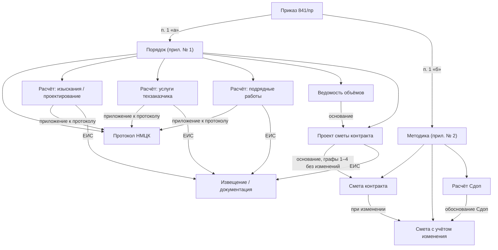

# Приказ Минстроя России от 23.12.2019 № 841/пр — машиночитаемое описание приложений

Оцифрован состав и порядок оформления приложений к приказу 841/пр: перечень форм,
их назначение, структура, таблицы, реквизиты и показатели, правила заполнения и
связи с пунктами приказа, Порядка и Методики.

- Данные: [`order-841-pr.json`](./order-841-pr.json)
- Схема: [`order-841-pr.schema.json`](./order-841-pr.schema.json)
- Проверка: `npm run check:841` → [`scripts/check-order-841.mjs`](../../../scripts/check-order-841.mjs)

Редакция — от 15.09.2025 (изменяющие приказы 500/пр, 728/пр, 124/пр, 484/пр,
556/пр). Модель не заменяет официальный текст; юридически значим опубликованный
текст действующей редакции.

## Что оцифровано

Приказ утверждает два документа (п. 1):

| Документ | Приложение к приказу | Внутренние приложения |
| --- | --- | --- |
| Порядок определения НМЦК | № 1 | № 1–6 к Порядку |
| Методика составления сметы контракта | № 2 | № 1–3 к Методике |

Итого 9 форм. Из них 4 размещаются в ЕИС (расчёты НМЦК и проект сметы), остальные
являются внутренними документами заказчика или приложениями к контракту.

## Перечень приложений

| ID | Форма | Назначение | Пункт-основание | Куда попадает |
| --- | --- | --- | --- | --- |
| `poryadok-app-1` | Протокол НМЦК | Зафиксировать результат определения цены | п. 7 Порядка | Внутренний документ; к нему прилагаются расчёты |
| `poryadok-app-2` | Расчёт НМЦК по изысканиям и проектированию | Оформить расчёт цены проектных и изыскательских работ | п. 15 Порядка | ЕИС — извещение / документация |
| `poryadok-app-3` | Расчёт НМЦК услуг технического заказчика | Оформить расчёт цены услуг техзаказчика | п. 19 Порядка | ЕИС — извещение / документация |
| `poryadok-app-4` | Расчёт НМЦК подрядных работ | Оформить расчёт цены строительства, реконструкции, капремонта, сноса, сохранения ОКН | п. 24 Порядка | ЕИС — извещение / документация |
| `poryadok-app-5` | Ведомость объёмов конструктивных решений и комплексов работ, оборудования | Детализировать объект и определить объёмы | п. 31 «б», 32, 33 Порядка | Основа для проекта сметы |
| `poryadok-app-6` | Проект сметы контракта | Определить цену каждого элемента в пределах НМЦК | п. 31 «в», 34–41 Порядка | ЕИС — документация; основа сметы контракта |
| `metodika-app-1` | Смета контракта | Заключить контракт с ценами, сниженными пропорционально НМЦК | п. 3–7 Методики | Приложение к контракту |
| `metodika-app-2` | Смета контракта (с учётом изменения) | Отразить изменение объёмов, видов работ и стоимости | п. 8–12, 14 Методики | Приложение к соглашению об изменении |
| `metodika-app-3` | Расчёт по договору (Сдоп) | Обосновать рост стоимости ценообразующих ресурсов | п. 14.1 Методики | Приложение к расчёту изменения цены |

## Структура приложения в модели

Каждое приложение описано одинаковым набором полей:

- `purpose` — назначение формы;
- `legalBasis` — пункты, которые обязывают применять форму;
- `applicability` — случаи применения;
- `placement` — где размещается документ (`publishInEis`, вложения);
- `headerFields` — реквизиты шапки (объект, адрес, основания, подписи);
- `tables[]` — таблицы: `columns[]` (номер графы, подпись, тип данных, единица,
  обязательность, источник, вычисляемое выражение), `rows[]`, `totalRows[]`,
  `invariants[]`;
- `footerFields` — реквизиты подвала (сроки, расчёт индекса);
- `fillRules[]` — правила заполнения со ссылкой на пункт;
- `notes` — особенности бланка;
- `relatedAppendices`, `formulaRefs` — связи.

Типы данных: `text`, `text_list`, `money`, `number`, `integer`, `percent`, `date`,
`attachment_list`, `signature`, `formula_text`. Денежные показатели — в рублях,
суммы в протоколе — «цифрами и прописью».

## Карта взаимосвязей



В JSON связи формализованы массивом `relations` (38 рёбер). Типы связей:
`approves`, `limits_application`, `transitional_application`, `requires_form`,
`defines_content`, `defines_price`, `defines_fill`, `attachment`, `basis_for`,
`evolves_to`, `placed_in_eis`, `computes_column`.

## Ключевые правила заполнения

| Форма | Правило | Пункт |
| --- | --- | --- |
| Протокол | Указывать НМЦК цифрами и прописью; прилагать все расчёты | п. 7 |
| Протокол | При неопределяемом объёме — цена единицы, сумма цен единиц, максимальное значение цены | п. 6 |
| Расчёты НМЦК | Графа 4 = графа 2 × графа 3; графа 6 = графа 4 × графа 5 | п. 12, 18, 22 |
| Расчёт по изысканиям | Индекс фактической инфляции — в графе 3, с подтверждающими документами | п. 15 |
| Ведомость | Технологически законченные элементы; «комплекс» для разнородных работ; объёмы по этапам | п. 33 |
| Проект сметы | Цена элемента: Ц = Спр × Кинф (формула 9) | п. 35 |
| Проект сметы | Прочие работы — отдельной строкой с единицей «комплекс»; временные здания — отдельной строкой | п. 38–41 |
| Смета контракта | Графы 1–4 — из проекта без изменений; графы 5–6 — с пропорциональным снижением НМЦК | п. 3, 4 Методики |
| Смета с изменением | Цена за единицу не меняется, если изменилось только количество | п. 9, 14 Методики |
| Расчёт Сдоп | Не менее 80 % стоимости ресурсов; не менее 3 обосновывающих документов; минимальная цена | п. 14.1 Методики |

## Формулы

В модели 19 формул с идентификаторами:

- `f1`, `f1-1` — месячный и периодный индексы прогнозной инфляции (п. 8);
- `f1-2` — цена проектных и изыскательских работ (п. 13);
- `f2` — НМЦК при сроке более года (п. 23);
- `f3`–`f8` — расчёт остатков при расторжении контракта (п. 25–28);
- `f9` — цена конструктивного решения (п. 35);
- `m-add`, `m-corr`, `m-corr2` — изменение сметы (п. 10, 10.1 Методики);
- `m-dop`, `m-new`, `m-kuv`, `m-cnov`, `m-kkor` — расчёт Сдоп и корректировка цены
  (п. 14.1, 14.2 Методики).

## Выявленные особенности и расхождения бланков

Зафиксированы в `consistencyNotes`:

1. **Сноска к приложению № 2 Методики.** Формулировка «произведение значений граф
   4 и 5» унаследована от семиграфной формы приложения № 1. В десятиграфной форме
   корректно: графа 8 = графа 4 × графа 6; графа 9 = графа 5 × графа 7.
2. **Приложение № 2 к Порядку.** В подвале указана «Продолжительность
   строительства», хотя форма относится к проектированию; в шапке —
   «Продолжительность проектирования».
3. **Протокол НМЦК.** Бланк содержит «Расчет» в единственном числе, а п. 7 требует
   приложить расчёты (множественное число).
4. **Приложение № 5 к Порядку.** В наименование добавлено оборудование, но графы
   для страны происхождения нет — она указывается в проекте сметы и смете.
5. **Приложение № 3 к Методике.** Применяется к контрактам, заключённым до
   31.12.2022, при условиях п. 14 Методики; для новых контрактов не применяется.
6. **Индекс фактической инфляции** указывается в графе 3 расчёта только при
   применении официальной статистики или индексов субъекта РФ.

## Использование

```bash
npm run check:841
```

Скрипт проверяет:

- уникальность идентификаторов документов, пунктов, приложений, формул и связей;
- наличие обязательных полей и отсутствие полей, не описанных в JSON-схеме;
- существование всех ссылок `legalBasis`, `relatedAppendices`, `formulaRefs`,
  `fillRules[].clause`, `relations.from/to`;
- непрерывную нумерацию граф и уникальность их идентификаторов;
- согласованность `summary` с фактическим составом приложений;
- наличие таблиц у всех форм, кроме протокола;
- ожидаемый состав: 6 приложений к Порядку и 3 к Методике.

Пример чтения модели в коде:

```js
import data from "./docs/legal/841-pr/order-841-pr.json" with { type: "json" };

const estimate = data.appendices.find((item) => item.id === "poryadok-app-6");
const columns = estimate.tables[0].columns.map(({ no, label }) => `${no}. ${label}`);
const rules = estimate.fillRules.filter((rule) => rule.clause === "poryadok-p35");
```

## Точки интеграции в CSMS

- Расчёт НМЦК: [`src/services/Nmck/nmck.schema.ts`](../../../src/services/Nmck/nmck.schema.ts),
  [`src/services/Nmck/marketNmck.ts`](../../../src/services/Nmck/marketNmck.ts),
  [`src/services/Nmck/regulatedTariffs.ts`](../../../src/services/Nmck/regulatedTariffs.ts).
- Проект контракта и смета: [`src/services/ContractProject/contractProject.schema.ts`](../../../src/services/ContractProject/contractProject.schema.ts),
  [`src/services/ContractProject/contractDocument.ts`](../../../src/services/ContractProject/contractDocument.ts).
- Выгрузка в ЕИС: [`src/services/Eis/eisExport.ts`](../../../src/services/Eis/eisExport.ts).
- Юридические акты и ссылки на них: [`src/services/LegalAct/legalAct.schema.ts`](../../../src/services/LegalAct/legalAct.schema.ts).

Модель можно использовать как справочник для построения форм, проверки
обязательных граф и генерации документов без дублирования текста приказа в коде.
